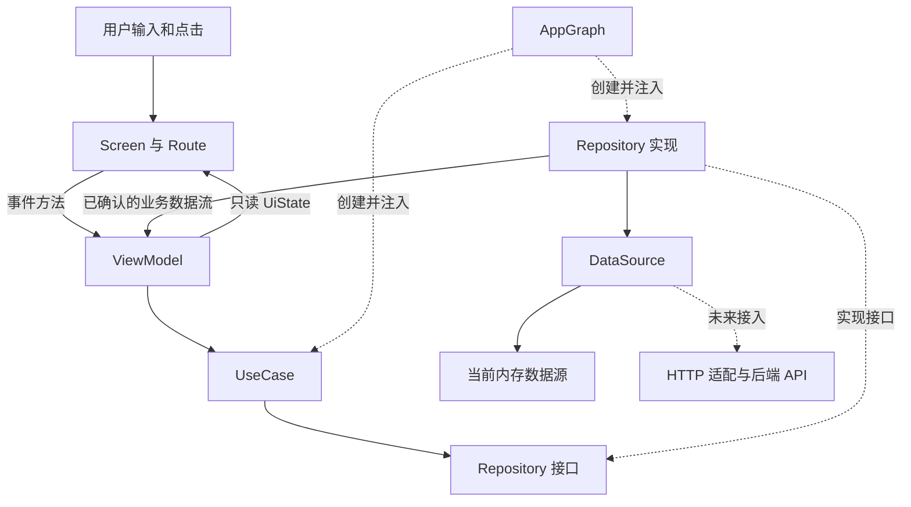

# 开序 Kotlin 双端客户端分层与功能开发指南

这份指南说明：一项开序业务从点击按钮到请求后端、再到界面更新，应拆成哪些文件，各层通过什么关系连接。项目采用 Kotlin Multiplatform 和 Compose Multiplatform，两端独立维护界面，共享可复用的业务和数据代码；目录按“先分层，再分业务”组织，让你能像阅读熟悉的后端仓库一样，从职责找到文件。

文中“当前示例”指可运行的个人任务标题录入；“后续方案”指接入 SRS 完整功能时的开发位置。只有 README 的目录尚无对应实现。服务端仍是现有 FastAPI 预留结构，没有因为客户端重构而切换技术栈。

## 1 客户端

```text
用户输入 / 点击
    ↓
Screen / Route          画页面、绑定操作
    ↓
ViewModel               接收事件、维护草稿和页面状态
    ↓
UseCase                 完成一个客户端业务动作
    ↓
Repository 接口         声明业务需要的数据能力
    ↓ 实际调用注入的实现
Repository 实现         协调数据源、维护已确认的数据
    ↓
DataSource              内存，或未来的 HTTP / 本地缓存适配
    ↓ 真实 HTTP 接入后
后端 Router / Controller → 后端 Service → 后端 Repository → 数据库
```

## 2 现在应该打开哪些目录

在 IDE 中打开 [apps/client](../../apps/client/)，它是完整 Gradle 工程。三个模块保留，避免把业务分层误解成必须创建很多 Gradle 模块。

```text
Project/apps/client/
├── androidApp/src/main/kotlin/com/kaixu/android/
│   ├── MainActivity.kt
│   ├── app/                         AndroidApp、AndroidAppContainer
│   └── presentation/                本端 ui、navigation、theme、components
│       ├── viewmodel/               本端专属流程，预留
│       └── state/                   本端专属状态，预留
├── desktopApp/src/main/kotlin/com/kaixu/desktop/
│   ├── Main.kt
│   ├── app/                         DesktopApp、DesktopAppContainer
│   └── presentation/                本端 ui、navigation、theme、components
│       ├── viewmodel/               本端专属流程，预留
│       └── state/                   本端专属状态，预留
├── shared/src/
│   ├── commonMain/kotlin/com/kaixu/
│   │   ├── app/di/                  AppGraph 公共依赖装配
│   │   ├── presentation/
│   │   │   ├── state/tasks/         共享 TaskEditorUiState
│   │   │   └── viewmodel/tasks/     共享 TaskEditorViewModel
│   │   ├── domain/
│   │   │   ├── model/tasks/         Task
│   │   │   ├── validation/tasks/    TaskTitle
│   │   │   ├── repository/         TaskRepository 接口
│   │   │   └── usecase/tasks/       创建、订阅、刷新
│   │   ├── data/
│   │   │   ├── repository/         DefaultTaskRepository
│   │   │   ├── datasource/         接口、memory、remote/local 预留
│   │   │   ├── dto/tasks/          HTTP 协议，预留
│   │   │   └── mapper/             数据转换，预留
│   │   └── core/                   network、session、platform，预留
│   ├── commonTest/                 公共规则和交互逻辑测试
│   ├── androidMain/                库的 Android 适配，预留
│   └── jvmMain/                    库的桌面 JVM 适配，预留
└── gradle/                         版本与 Wrapper
```

每个有意义的分层目录都有 README。后续增加工作区业务时，在各端 `presentation/ui/workspaces`、共享 `domain/model/workspaces`、`domain/usecase/workspaces` 等对应位置增包，不再引入与现有层重复的另一套 `features/workspaces/data`。

`.kt` 编写类与 Compose 函数，`.md` 写职责与设计，`.gradle.kts` 配置构建。包名和目录一致，例如 `com.kaixu.presentation.viewmodel.tasks`。这里只用普通 Kotlin 包表达分层；当前不会由 Gradle 强制阻止同模块内的越层导入。

## 3 各层具体应该写怎样的代码

| 位置 | 应写代码 | 可以调用 | 不放在这里的内容 |
| --- | --- | --- | --- |
| 各端 presentation/ui | `@Composable fun TaskEditorScreen(state, onSaveClicked)` | UI 组件、通过回调发送事件；Route 订阅 VM | HTTP、SQL、保存权限判断 |
| 共享或各端 presentation/state | `data class TaskEditorUiState(...)` | 可引用业务模型或专用显示模型 | JSON 协议、数据库格式 |
| 共享或各端 presentation/viewmodel | 事件方法、协程、StateFlow、失败恢复 | UseCase、纯校验规则 | 网络库、平台窗口、数据源实现 |
| domain/usecase | `suspend operator fun invoke(input)` | Repository 接口、domain 规则 | Compose 状态、HTTP 路径、弹窗 |
| domain/repository | 接口与业务方法签名 | domain model、协程流 | 接口实现、传输对象 |
| data/repository | 接口实现、刷新和成功数据发布、缓存协调 | 数据源、mapper | 页面草稿、导航、表单提示 |
| data/datasource | 内存读写，未来的远程和本地适配 | 网络或存储设施、DTO、mapper | 页面交互流程 |
| data/dto | 请求 / 响应 data class | 序列化工具，接 API 时引入 | UI 加载状态、领域算法 |
| data/mapper | `Dto.toDomain()` 等转换函数 | DTO、业务模型、缓存模型 | 发请求、弹窗、状态订阅 |
| domain/model | Task、WorkSession 等业务对象 | 通用类型 | UI 控件、JSON 命名、数据库驱动 |
| domain/validation | 标题、时间区间等可复用纯函数 | 通用类型和业务对象 | HTTP、读取会话、绘图 |
| 共享 app/di 与各端 app | 创建和连接对象 | 各层接口与实现 | 业务决策 |
| core | 多业务共用的技术能力 | 通用设施，平台实现通过接口连接 | 任务专属业务逻辑 |

Repository 为什么有两个位置？`domain/repository/TaskRepository.kt` 是承诺“我能做什么”的接口，`data/repository/DefaultTaskRepository.kt` 是说明“我怎么做”的实现。UseCase 的构造参数只写接口类型；运行时注入的是实现对象。

## 4 调用方向与源码依赖方向



运行时，UseCase 调接口方法，实际由实现对象执行。源码上却是 data 实现依赖 domain 接口，domain 不导入 data；这称为依赖倒置。理解这点就能知道为什么接口和实现分开放。

约束如下：表现层可以依赖 domain；data 可以依赖 domain 与基础设施；domain 不依赖表现层和数据实现；app/di 允许知道各层以完成装配；各端 Navigation 作为页面装配入口接收 AppGraph，为目的地注入 UseCase。基础设施不能反过来调用页面。服务器是 HTTP 边界另一侧的独立进程。

## 5 状态放在哪里 模型如何区分

| 类型 | 例子 | 放在哪里 | 生命周期或来源 |
| --- | --- | --- | --- |
| 页面草稿与交互状态 | draftTitle、isSaving、字段错误、冲突比较 | presentation/state，由 ViewModel 管理 | 页面编辑期间；失败保留 |
| 已确认的业务数据 | Task(id, title) | domain/model，由仓储提供 | 当前示例仅进程内；正式来源是服务端 |
| 数据快照 | 已确认任务 StateFlow | data/repository 实现中私有可变、公开只读 | 同一应用或账号范围共享 |
| HTTP 模型 | CreateTaskRequestDto、TaskResponseDto | data/dto，未来实现 | 单次请求 / 响应 |
| 本地缓存记录 | TaskEntity、账号标识、缓存更新时间 | data/datasource/local，未来实现 | 持久化缓存 |
| 账号会话 | accountId、凭据、会话有效性 | core/session，未来实现 | 登录到退出 |
| 纯视觉临时状态 | 菜单展开、焦点、滚动位置 | Screen 内适当的 Compose 状态 | 组件生命周期 |

保存成功的模型和正在编辑的草稿必须区分。用户输入“修改后的标题”并不意味着服务端已经保存；网络失败时应该显示原记录与仍可重试的草稿。后续正式编辑请求从 UiState 中取业务输入，再转为命令或 DTO，而不是直接序列化整个 UiState。

普通 ViewModel 能跨部分宿主重建保留状态，但不能保证应用进程被终止后仍保留草稿。当前示例不实现进程重启恢复或持久化。SRS 对中断在线保存的输入保留要求限于编辑会话仍打开的情形。

## 6 顺着当前真实代码完成一次新增任务

共享类型路径相对于 `shared/src/commonMain/kotlin/com/kaixu/`；页面在各端源码根。以下以桌面页面为例，Android 有独立的同职责 Screen 和 Route。

### 第一步 画表单并发送事件

[TaskEditorScreen.kt](../../apps/client/desktopApp/src/main/kotlin/com/kaixu/desktop/presentation/ui/tasks/TaskEditorScreen.kt) 接收 `TaskEditorUiState`，输入框显示 `state.draftTitle`。输入改变调用 `onTitleChanged`，按钮调用 `onSaveClicked`。

[TaskEditorRoute.kt](../../apps/client/desktopApp/src/main/kotlin/com/kaixu/desktop/presentation/ui/tasks/TaskEditorRoute.kt) 负责接线：

```kotlin
val state by viewModel.uiState.collectAsStateWithLifecycle()
TaskEditorScreen(
    state = state,
    onTitleChanged = viewModel::onTitleChanged,
    onSaveClicked = viewModel::onSaveClicked,
    onCancelSaveClicked = viewModel::onCancelSaveClicked,
)
```

打字只更新草稿，不会创建 Task。

### 第二步 ViewModel 控制页面行为

[TaskEditorViewModel.kt](../../apps/client/shared/src/commonMain/kotlin/com/kaixu/presentation/viewmodel/tasks/TaskEditorViewModel.kt) 先检查当前是否加载或保存，再调用共同标题规则即时提示错误。通过后立即设置 `isSaving=true`，避免连续点击发出多个请求，然后在 `viewModelScope` 调用 `createTask(titleToSave)`。

[TaskEditorUiState.kt](../../apps/client/shared/src/commonMain/kotlin/com/kaixu/presentation/state/tasks/TaskEditorUiState.kt) 定义草稿、任务列表、加载与保存状态、消息。ViewModel 持有私有 MutableStateFlow，只向页面暴露只读 StateFlow。

### 第三步 UseCase 表达业务动作

[CreateTaskUseCase.kt](../../apps/client/shared/src/commonMain/kotlin/com/kaixu/domain/usecase/tasks/CreateTaskUseCase.kt) 的工作是：

```kotlin
suspend operator fun invoke(rawTitle: String) {
    val error = TaskTitle.errorOrNull(rawTitle)
    require(error == null) { error ?: "无效标题" }
    repository.create(rawTitle.trim())
}
```

ViewModel 和 UseCase 复用同一条 [TaskTitle](../../apps/client/shared/src/commonMain/kotlin/com/kaixu/domain/validation/tasks/TaskTitle.kt) 规则。前者用于立即反馈，后者保证其他入口直接使用该业务动作时也有效。规则没有两份拷贝。120字符是教学约定，SRS只明确标题必填；正式限制需与后端确认。

观察列表和刷新分别交给 ObserveTasksUseCase、RefreshTasksUseCase。本项目保留它们使调用形式统一；真实小功能也可以只对复杂或复用的动作建立 UseCase，避免机械增加空壳。

### 第四步 仓储协调成功数据

[TaskRepository.kt](../../apps/client/shared/src/commonMain/kotlin/com/kaixu/domain/repository/TaskRepository.kt) 约定 `tasks`、`refresh()`、`create(title)`。UseCase 只认识这份接口。

[DefaultTaskRepository.kt](../../apps/client/shared/src/commonMain/kotlin/com/kaixu/data/repository/DefaultTaskRepository.kt) 实现接口，调用 `source.createTask(title)`，只有成功返回后才发布列表快照。失败不先插入一条假任务。这里的 Mutex 只协调单个仓储对象内的访问，不能代替跨设备并发控制。

### 第五步 数据源真正创建记录

[TaskDataSource.kt](../../apps/client/shared/src/commonMain/kotlin/com/kaixu/data/datasource/TaskDataSource.kt) 定义实际读写入口。[InMemoryTaskDataSource.kt](../../apps/client/shared/src/commonMain/kotlin/com/kaixu/data/datasource/memory/InMemoryTaskDataSource.kt) 等待600毫秒，再创建包含 ID 和标题的 Task。

内存实现没有 HTTP，所以当前不需要 DTO 或 mapper 源码。它关闭就丢失，Windows 与 Android 各自运行时也不会同步。

### 第六步 数据与页面状态返回

保存成功：数据源返回 Task → 仓储更新 tasks → ObserveTasksUseCase 提供同一数据流 → ViewModel 把列表写入 UiState；保存协程清空草稿并显示成功消息 → Screen 随状态重绘。

保存失败：数据源抛异常 → 仓储不更新成功数据 → ViewModel 显示失败并保留草稿 → 用户显式重试。取消异常重新抛出，不显示为普通失败；结束时恢复保存按钮。

两条状态路径各有职责：仓储发布“已经确认的数据”，保存协程维护“提交交互是否成功”。不把按钮状态塞进 Task。

### 第七步 在装配处把所有层连起来

[AppGraph.kt](../../apps/client/shared/src/commonMain/kotlin/com/kaixu/app/di/AppGraph.kt) 按以下关系创建对象：

```text
InMemoryTaskDataSource
    → DefaultTaskRepository : TaskRepository
        → CreateTaskUseCase / ObserveTasksUseCase / RefreshTasksUseCase
            → TaskEditorViewModel
                → TaskEditorRoute → TaskEditorScreen
```

AndroidAppContainer 与 DesktopAppContainer 分别在宿主范围持有 AppGraph；各端 Navigation 在各自 NavBackStackEntry 范围取得页面 ViewModel。仓储由应用共享，页面草稿由导航条目保留；Compose 重绘不重新创建这些对象。后续账号切换仍需明确清理依赖。具体代码与生命周期见 [导航接入设计](client-navigation.md)。

## 7 后续如何与后端联调

这部分是开发步骤，当前未实现真实 HTTP。

1. 在 `Project/contracts/` 确认接口：路径、方法、请求与响应、认证、错误类型、版本和幂等约定。当前没有可用的 `openapi.json`，不能把示意字段当成正式合同。
2. 在 `core/network/` 配置 HTTP 客户端与环境基地址；平台引擎放相应源集，添加所需依赖。
3. 在 `data/dto/tasks/` 写请求和响应模型，只包含协议字段。
4. 在 `data/mapper/` 写 DTO 与业务对象转换，处理日期精度、状态枚举、空值和 ID 类型。
5. 在 `data/datasource/remote/` 实现 HttpTaskDataSource，内部解析 DTO 并转换为 Task，对外遵守数据源接口。
6. 根据需要在仓储中协调远程与个人只读缓存，并处理权限失效、版本冲突和会话边界。
7. 在 AppGraph 替换实现。若业务接口和错误约定稳定，Screen、ViewModel、UseCase 不需要知道 Ktor 或后端 URL。
8. 进行同账号的 Windows 创建 → Android 刷新与修改 → Windows 刷新的联调；再检查失败、冲突、断网、退出和换号。

当前 Task 只有 Long ID 和标题，是最小内存演示。接正式 API 时通常还需扩展业务字段、请求输入与可识别错误，不能承诺只换一个类便完成全 SRS。数据传输的类型变化应在 DTO 和 mapper 收口。

读取失败和保存失败必须可区分；版本冲突需要返回最新记录供比较，403需要使共享内容失效，401需要进入会话失效处理。可以在 domain 中定义上层可识别的失败类型，由数据层将协议错误转换，ViewModel 再转成页面状态。示例目前只有统一错误文字，尚未实现这些结果类型。

HTTP 超时或取消不能证明服务器未提交。正式写操作需保留本次操作标识，在契约支持下查询结果或用同一幂等键显式重试；按钮防连点不等于跨端幂等。

## 8 按 SRS 将客户端业务拆到各层

这些是后续业务包规划，不是已实现功能。新建相应包时沿用现有层级，先交付完整用例，再增加细节。

| 业务及 SRS | 页面与页面状态 | UseCase 与模型 | 数据与后端重点 |
| --- | --- | --- | --- |
| 账号 FR-X01、X06 | 登录表单、会话失效和退出 | SignIn、SignOut；账号身份 | 凭据与账号缓存隔离、旧请求失效 |
| 工作区 FR-W01～W06 | 目录、概览、归档状态 | Create / Archive / Restore Workspace；Workspace | 归档规则、课程隐私、跨视图相同记录 |
| 任务 FR-T01～T04 | 编辑、筛选、详情 | Create / Update / Delete Task；Task | 版本、来源、删除关联处理 |
| 排程 FR-S01～S11 | 周视图、时段编辑、冲突确认 | ScheduleTask、CompleteTask；FixedEvent、WorkSession | 私有时段、区间与截止校验、原子完成命令 |
| 协作 FR-C01～C09 | 邀请、成员、负责人、版本比较 | AcceptInvitation、ChangeAssignee；Membership | 成员资格、幂等、不可访问他人私人安排 |
| 资源 FR-R01～R06 | 资源列表、关联选择、后续版本页 | LinkResourceToTask；Resource、TaskResourceLink | 同工作区限制、每次请求鉴权、附件版本 |
| 信息收集 FR-I01～I08 | 来源、候选收件箱、字段比较 | ConfirmCandidate；Candidate、SourceReference | 外部检索在服务端适配，去重与确认原子性 |
| 刷新与缓存 FR-X03～X06 | Saving / Synced / Failed、离线提示 | 各业务 Refresh、版本比较 | 个人只读缓存、共享内容在线校验，无离线写队列 |

Windows 与 Android 的编辑范围不同，业务对象与规则仍一致。两端根界面、导航、页面和主题已独立，当前标题录入才共用相同的 ViewModel 与 UiState。Windows 提供详细管理，Android 提供快速查看和轻操作；SRS 8.8 明确移动端共享固定事件只读。可以用同一组 UseCase 搭不同布局或不同页面，不需要复制业务层。

### 例子一 完成任务并选择如何处理未来时段

SRS FR-S07 要求确认后原子提交。按以下方式拆分：

- UI：打开确认界面，显示“保留 / 取消我的未来时段”；取消确认只关闭界面。
- UiState：保存确认框是否打开、用户选择、提交中状态、失败与版本比较信息。
- ViewModel：发起确认流程，确认后调用业务动作；失败保留选择，不预先标成已完成。
- UseCase：接收任务 ID、当前版本和个人时段处理选择，校验输入，交给仓储。
- Repository / 远程数据源：发送一个完成命令；服务端以事务更新任务状态及本人的未来时段。
- 返回链：成功后刷新任务与本人的排程；失败时两者都保持原状。

不能从客户端先发“标完成”再循环发“删时段”，否则部分请求失败会破坏原子性。其他用户的私人时段与历史时段不得改动。

### 例子二 为任务关联一个资源

UI 选择资源；UiState 保存 taskId、workspaceId、选中 resourceId 与提交状态；ViewModel 调 LinkResourceToTaskUseCase；UseCase 检查可获得的工作区信息并请求仓储；远程数据源调用关联接口。服务端最终校验双方属于同一工作区且用户有权限，成功后仓储发布新的关联数据。

解除关联只删除 TaskResourceLink，不删除 Resource。需要将私人资源用于共享项目时，按 SRS 先创建共享资源记录并确认可见范围，不在 mapper 中悄悄转换归属。

## 9 影响架构的 SRS 边界

- FR-X05：离线只读当前账号个人缓存并显示更新时间；共享内容要求在线权限校验；没有离线写队列，重连不自动提交草稿。
- FR-C06、S08：项目任务可共享，个人执行时段和剩余估时仍私有；不能用项目详情接口返回所有人的私人安排。
- FR-X06、C08、BR09：个人与共享记录都要考虑跨端版本冲突；保留草稿，比较最新记录，再显式提交。
- FR-S05、S06、BR02：重叠和超过截止先提示再确认；时间区间按半开区间计算，相邻首尾相等不算冲突。
- BR13：应用日期与时间统一 Asia/Shanghai；日期型截止仍是日期，不能随设备时区漂移或擅自转为某个时刻。
- FR-W06、BR11、表17A：归档保留历史，工作区内容只读；已有个人时段仍可由本人调整或取消，不一律禁用所有操作。
- BR15：删任务不能简单级联删除所有人的私人时段；后端处理脱链和访问清理，客户端按返回更新状态。
- FR-I04、I05：候选去重、源版本和记录版本校验在服务端保证；UseCase 负责确认流程，外部适配不能擅自覆盖用户字段。

这些约束应同时影响契约、后端校验、客户端状态与验收。客户端隐藏按钮只是交互提示，服务器始终负责最终授权。

## 10 新增一个功能时的实施顺序

1. 写明用例、SRS编号、成功结果和失败恢复，例如“同工作区选择资源并关联，失败保留选择”。先区分这次输入是草稿还是已保存数据。
2. 确认模型和接口契约：业务对象放 domain/model，协议放 contracts；后端未就绪可先用内存替身验证调用链。
3. 在 domain/repository 声明能力；在 domain/usecase 写动作与纯规则。单纯读取可复用现有能力，不必重复造仓储。
4. 在 data 实现仓储与所需数据源；需要 HTTP 时再增加 DTO 与 mapper；权限、事务等交给后端接口。
5. 相同交互在 shared/presentation 定义状态与 ViewModel；本端特有交互在对应 App 的 presentation/state、viewmodel 定义。失败、重试与冲突要有明确状态。
6. 在各端 ui 写 Screen 和 Route；shared/app/di 装配公共依赖，各端 app 管理宿主范围，各端 navigation 装配页面 ViewModel 和跳转。
7. 检查规则边界、成功、失败、保留草稿、重复点击和取消；涉及服务端时增加权限、版本、幂等与跨端刷新验收。

一项功能不必修改每个层级。只调整按钮颜色改 UI；修改标题规则改 validation 及相应测试；替换 HTTP 环境改配置或装配；新增事务行为才涉及契约与后端。以职责决定文件，不以“必须改满所有目录”决定。

## 11 双端目录拆分与新文件归属

| 原位置（公共包下） | 当前位置（对应包下） |
| --- | --- |
| app/App.kt | 两端 app/AndroidApp.kt、app/DesktopApp.kt |
| app/AppSessionViewModel.kt | 两端 app/AndroidAppContainer.kt、app/DesktopAppContainer.kt |
| presentation/ui | 两端 presentation/ui，分别维护 Screen、Route |
| presentation/navigation | 两端 presentation/navigation，分别维护目的地与返回栈 |
| presentation/components | 两端 presentation/components，当前仅预留 |
| 根界面中的 MaterialTheme | 两端 presentation/theme/KaiXuTheme.kt |
| TaskEditorViewModel、TaskEditorUiState | 继续放 shared/presentation 的对应包 |
| domain、data、core、app/di | 继续放 shared 的对应包 |

完整路径见第 2 节，各职责目录 README 给出适宜文件、协作边界与实现范围。不要只在 commonMain 新建 ui/android、ui/windows 便认为完成平台隔离：普通包名不会改变编译目标。当前各端承载完整页面，shared 不再依赖 Compose UI 或导航；共享 ViewModel 仍依赖 Lifecycle ViewModel 核心。

shared 是多平台库，commonMain 是跨平台公共源集，androidMain/jvmMain 是库内部的平台适配。当前两个平台目录尚无适配源码。库需要的平台能力可放相应源集；依赖宿主的权限、窗口等可在 App 实现公共接口并注入。共享层不能反向依赖 App。

本次保留标题示例的功能，没有实现完整桌面编辑器或 Android 今日页。源码已可独立演进；共享代码也不代表两个进程共享数据。实测见 [双端拆分验证](../04-testing/client-platform-split-verification.md)，较早分层迁移见 [历史记录](../04-testing/client-layer-refactor-verification.md)。

## 12 阅读与验证入口

建议顺序：本指南 → [导航接入设计](client-navigation.md) → 各层 README → TaskEditorScreen → TaskEditorViewModel → CreateTaskUseCase → TaskRepository → DefaultTaskRepository → InMemoryTaskDataSource → AppGraph → 测试。

运行与构建命令见 [客户端 README](../../apps/client/README.md)。当前示例仅覆盖 FR-T01 中最小手工录入的一部分；不代表估时、截止、账号、持久化、同步或 Windows / Android 全功能验收完成。

设计依据是工作区中的 [SRS](../../../KaiXu_Software_Requirements_Specification_Submission_Final.docx) 第2.4、5.2～5.7、5.12、7和8章，以及现有客户端源码。外部参考只用于解释模式与命名，本目录组织是针对本项目的取舍：

- [原项目 README 与后端分层](https://github.com/2637321927/Campus-Secondhand-Trading-Platform#readme)：Controller / Service / Repository / DTO / Data 的职责参考。
- [Android 应用架构指南](https://developer.android.com/topic/architecture)：UI、数据与可选业务层以及状态流向。
- [Android Domain layer](https://developer.android.com/topic/architecture/domain-layer)：UseCase 的业务复用与可选性；这里将仓储接口放 domain 是本项目约定。
- [Compose Multiplatform 与 Jetpack Compose](https://kotlinlang.org/docs/multiplatform/compose-multiplatform-and-jetpack-compose.html)：共享 Compose 代码与平台能力边界。
