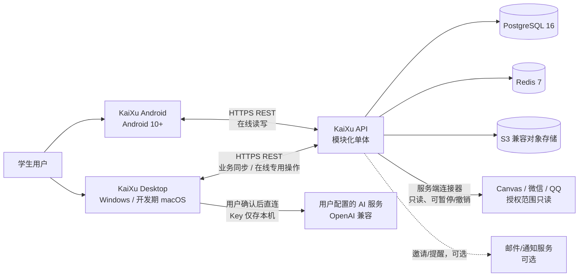
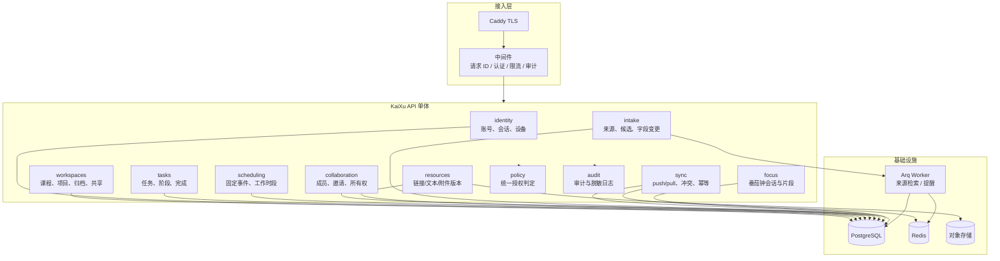
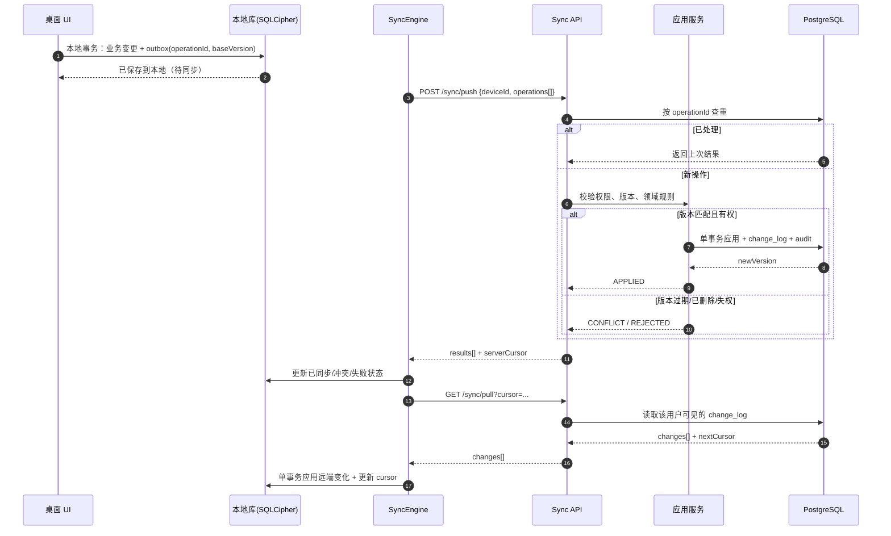
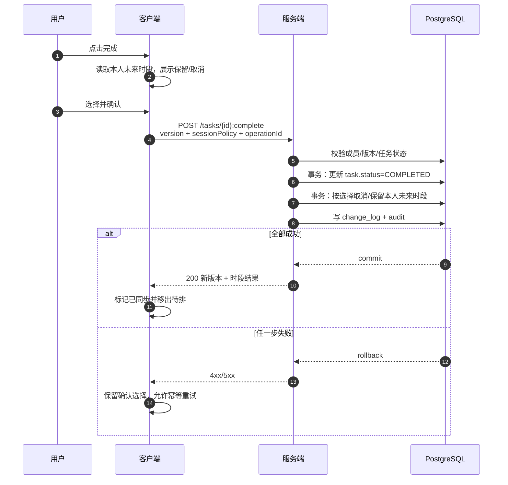

# KaiXu 架构设计

## 1 设计驱动与约束

### 1.1 业务驱动

| 驱动 | 对架构的影响 |
| --- | --- |
| 桌面是主工作台，未登录/断网也要能完成个人闭环 | 桌面必须本地优先，本地库是业务读写入口，服务端是同步对端而非唯一数据源 |
| Android 只做在线轻量操作 | Android 不引入业务本地库，直接读服务端；会话失效/断网即收起业务内容 |
| 项目共享与私人执行强隔离 | 服务端按字段投影私人数据；共享写操作每次复核成员资格；本地快照不能替代远程鉴权 |
| 完成、删除、候选确认涉及多表 | 明确事务边界；桌面本地事务与服务端事务各自原子，通过可重试同步衔接 |
| 外部来源和 AI 都是不确定依赖 | 适配器隔离；候选/建议与正式数据分离；失败保留人工路径 |
| 四人团队、九周交付 | 模块化单体、单一数据库、Docker Compose；避免微服务分布式事务和额外运维 |

### 1.2 质量属性优先级

1. **数据正确性**：不丢本地成果、不重复创建、不越权读写、不把失败显示为成功。
2. **隐私隔离**：私人时段、剩余估时、番茄钟明细不出现在他人响应、导出或日志中。
3. **可恢复性**：重启后本地记录仍在；同步失败可重试；冲突可比较后重新提交。
4. **可维护性**：模块边界清晰，双端共享领域规则，接口有契约样本。
5. **性能**：在 SRS 7.1 数据集下满足 NFR-P01–P05；不做超出课程环境的过度优化。

## 2 技术栈选择

| 层次 | 选型 | 版本基线 | 选择理由 | 放弃的方案 |
| --- | --- | --- | --- | --- |
| 桌面 UI | Kotlin + Compose Multiplatform | Kotlin 2.1、Compose 1.8、JVM 21 | 与 Android 共享语言、领域模型和 ViewModel；原生 Windows 安装包 | Electron（包体与内存高）、Flutter（团队已有 Kotlin 资产） |
| Android UI | Kotlin + Jetpack Compose | compileSdk 35、minSdk 29、Compose BOM 2025 | 与桌面共享领域层；Material 3 与无障碍支持成熟 | 原生 View（维护成本高）、WebView 套壳（离线/权限不可控） |
| 共享层 | Kotlin Multiplatform | KMP 2.1 | 双端复用领域模型、校验规则、UseCase、DTO 映射 | 两端各写一套（规则漂移） |
| 桌面本地库 | SQLite + SQLCipher，SQLDelight 2.x | SQLDelight 2.0、SQLCipher 4.6 | 类型安全 SQL、事务、可加密；离线优先 | Realm（加密/迁移约束）、纯文件（查询与事务弱） |
| Android 网络 | Ktor Client（OkHttp 引擎） | Ktor 3.x | 与 KMP 共享 DTO/客户端配置；支持超时、重试、日志脱敏 | Retrofit（仅 JVM/Android，共享层割裂） |
| 服务端 | Python 3.12 + FastAPI | FastAPI 0.115、Pydantic 2 | 团队已预留 FastAPI 结构；OpenAPI 自动生成；异步 I/O 适合外部来源 | Django（偏重）、Node/NestJS（团队栈不一致） |
| ORM / 迁移 | SQLAlchemy 2.0 async + Alembic | SQLAlchemy 2.0、asyncpg | 显式事务、异步查询、迁移成熟 | 手写 SQL 全量（可维护性差） |
| 主数据库 | PostgreSQL 16 | 16.x | 事务、约束、JSONB、部分唯一索引、全文/模糊搜索、成熟备份 | MySQL（部分索引与 JSONB 弱）、MongoDB（事务与关系约束弱） |
| 缓存/限流 | Redis 7 | 7.x | 会话撤销、限流、幂等短缓存、异步任务队列 | 仅内存（多副本不一致） |
| 对象存储 | S3 兼容（MinIO 开发 / 云 OSS 生产） | — | 附件版本、预签名 URL、服务端加密 | 数据库存二进制（备份与性能差） |
| 后台任务 | Arq（Redis） | 0.26 | 轻量、与 FastAPI 同栈；来源检索与通知异步化 | Celery（依赖多）、Kafka（过度） |
| 反向代理 | Caddy 2 | 2.x | 自动 TLS、配置简单 | Nginx（可替换，团队更熟时可换） |
| 可观测性 | OpenTelemetry + Prometheus + Grafana + 结构化日志 | — | 请求链路、错误率、同步延迟可查 | 仅 print 日志（不可诊断） |
| 接口契约 | REST/JSON + OpenAPI 3.1 | — | 客户端生成 DTO、联调样本明确 | GraphQL（查询复杂度不高，权限投影更复杂） |
| 认证 | JWT access + 旋转 refresh token + Argon2id | — | 无状态校验 + 可撤销刷新；密码哈希抗 GPU | 仅长期 JWT（难撤销）、明文/MD5（不合规） |
| AI | OpenAI 兼容 HTTP API，桌面直连 | — | 用户自备 Key；服务端不接触第三方凭据 | 服务端代理默认（Key 集中风险） |

### 2.1 版本与兼容策略

- API 使用 `/api/v1` 路径版本；破坏性变更升 `/api/v2`，旧版本至少保留一个迭代。
- 数据库迁移只前进（forward-only），每个迁移必须可在空库和上一版本库执行；生产回滚用备份恢复，不做 down migration。
- 桌面安装包升级保留本地库；迁移失败进入只读恢复模式，不删除用户数据。
- Android 最低 API 29（Android 10），与 SRS 7.1 验收环境一致。

## 3 系统上下文



**信任边界**：

- 桌面本地库属于用户设备，受操作系统账户与 SQLCipher 保护；服务端不假设本地数据可信。
- Android 不保存业务库，只保存会话令牌；所有业务内容以服务端确认为准。
- 外部来源和 AI 都是不可信外部服务；返回值必须经过字段校验、权限检查和用户确认。
- 对象存储不公开读；下载必须经过服务端鉴权后签发短时 URL。

## 4 服务端架构

### 4.1 模块化单体

选择**模块化单体**而不是微服务：

- 四人团队无法承担多服务部署、链路追踪、分布式事务和跨服务权限一致性的成本。
- 完成操作、候选确认、共享范围确认、删除脱链都需要单事务；单体更容易保证。
- 课程规模（20 工作区/1000 任务/2000 时段与事件/200 资料）远低于单服务瓶颈。
- 模块边界按业务能力划分，未来可按 intake、focus、sync 独立拆分。



### 4.2 模块职责与依赖

| 模块 | 职责 | 拥有的表 | 允许依赖 |
| --- | --- | --- | --- |
| identity | 注册、登录、刷新、退出、设备、用户设置 | `app_user`、`user_settings`、`device`、`refresh_session` | policy、audit |
| workspaces | 课程/项目 CRUD、归档/恢复、共享范围确认 | `workspace`、`workspace_share_snapshot` | policy、collaboration、audit |
| collaboration | 邀请、成员、角色、所有权交接 | `workspace_member`、`project_invitation`、`ownership_transfer` | policy、audit |
| tasks | 任务 CRUD、状态、阶段、个人剩余估时、完成命令 | `task`、`task_stage`、`task_stage_dependency`、`task_user_state` | policy、scheduling、audit |
| scheduling | 固定事件、工作时段、冲突检查 | `fixed_event`、`work_session` | policy、tasks（只读引用）、audit |
| resources | 资料、任务关联、附件版本、预签名 | `resource`、`resource_attachment`、`resource_task_link` | policy、audit |
| intake | 来源连接、凭据引用、检索、候选、字段变更 | `source_connection`、`source_credential`、`source_record`、`intake_candidate`、`candidate_field_change` | policy、tasks、scheduling、audit |
| sync | 桌面操作接收、幂等、版本冲突、变更拉取 | `sync_operation`、`change_log`、`tombstone`、`idempotency_key` | 通过应用服务调用各模块，不直接跨表写业务 |
| focus | 番茄钟会话、前后台片段、达标汇总 | `focus_session`、`focus_segment` | policy、tasks、scheduling、audit |
| policy | 统一授权：个人/共享/角色/私人字段 | 无（读模型） | identity、collaboration |
| audit | 审计事件、脱敏、请求上下文 | `audit_log`、`outbox_event` | 无 |

**依赖规则**：

1. Router → Application Service → Repository/Policy；Router 不直接访问 ORM Session。
2. 跨模块只调用对方 Application Service 的公开方法，不跨模块写表。
3. `sync` 是编排层：按 `entityType` 分派到 tasks/scheduling/resources/workspaces 的应用服务，事务由 sync 统一开启；被调用服务不自行 commit。
4. `policy` 是纯判定 + 必要查询，不写业务表；每次共享读写都调用。
5. 所有模块通过 `audit` 记录敏感动作，但日志不写完整原文、密码、令牌、Key。

### 4.3 请求处理链

```text
Caddy
  → RequestID / 访问日志（脱敏）
  → 认证（JWT 校验，加载 userId/deviceId/sessionId）
  → 限流（Redis，按 IP/用户/端点）
  → 路由（/api/v1/...）
  → Application Service
      → Policy 授权（共享资源逐次校验）
      → Repository（显式事务）
      → Domain 规则（时间、状态、版本、隐私）
      → 写 change_log / outbox / audit（同事务）
  → 响应 DTO（按可见字段投影）
  → 统一错误（RFC 9457）
```

### 4.4 事务边界

| 业务动作 | 事务范围 | 关键约束 |
| --- | --- | --- |
| 完成任务 UC11 | `task.status` + 操作者未来 `work_session` + `sync_operation`/`change_log`/`audit` | 同一事务；操作者只能处理自己的时段；`operationId` 幂等 |
| 确认候选 UC07 | `task`/`fixed_event` + 来源关系 + 候选状态 + change log | 候选版本与目标版本复核；`source_record` 唯一 |
| 接受排程草案 UC13 | 多条 `work_session` + 草案状态 | 全部成功或全部不写；锁定项不变 |
| 删除任务 UC06/BR15 | 任务软删 + 本人时段脱链 + 关联清理 | 单库事务；不级联删除他人时段 |
| 共享范围确认 UC14 | `workspace.visibility` + 快照 + 邀请 | 先同步个人项目；私人字段不进入快照 |
| 成员移除 UC14 | 成员状态 + 会话/权限失效标记 + 审计 | 服务端立即拒绝后续请求；历史保留 |
| 附件新版本 UC19 | `resource_attachment` + `resource.current_attachment_id` + 版本号 | 完整上传后才切换；旧版本保留 |

## 5 客户端架构

### 5.1 分层

双端沿用现有 KMP + MVVM 分层：

```text
Screen / Route
  → ViewModel（状态、草稿、错误、同步状态）
  → UseCase（一次业务动作）
  → Repository 接口
      → 本地数据源（仅桌面） / 远程数据源
      → 同步引擎（仅桌面）
  → DTO / Mapper / Domain Model
```

| 层 | 位置 | 桌面 | Android |
| --- | --- | --- | --- |
| UI | `desktopApp/presentation`、`androidApp/presentation` | Compose Desktop | Compose Material 3 |
| 状态/VM | `shared/presentation` + 端专属 | 完整状态机 | 轻量状态 |
| UseCase | `shared/domain/usecase` | 复用 | 复用 |
| 领域模型/规则 | `shared/domain` | 复用 | 复用 |
| Repository | `shared/domain/repository` | 本地优先 + 远程 | 仅远程 |
| 本地数据源 | `desktopApp/data/local`（SQLDelight/SQLCipher） | 有 | 无 |
| 远程数据源 | `shared/data/datasource/remote` | 有 | 有 |
| 同步引擎 | `desktopApp/data/sync` | 有 | 无 |
| 凭据/会话 | `desktopApp/core/credential`、`androidApp/core/session` | OS 凭据库 | Keystore + DataStore |

### 5.2 桌面 Local-first

桌面是**本地库优先**：

```text
用户操作
  → ViewModel 校验/草稿
  → UseCase
  → Repository（本地事务）
      → SQLDelight 写业务表
      → 同事务写 outbox（operationId、baseVersion、payload）
  → UI 显示“已保存到本地 / 待同步”
  → SyncEngine（后台）
      → push outbox
      → pull change_log
      → 更新本地表与 cursor
      → UI 显示“已同步 / 冲突 / 失败”
```

本地库按空间隔离：

- `guest`：未登录本地空间，不请求服务端。
- `user:<userId>`：每个账号一个加密库文件；退出时从内存移除密钥并锁定，不删除未同步数据。
- `sync_cursor`、`outbox`、`conflict` 均属于对应空间。
- 未登录数据不会因登录自动上传；用户必须显式“导入账号空间”。

### 5.3 Android Online-only

```text
页面进入 / 恢复前台 / 手动刷新
  → 检查登录 + 网络 + 服务可达
  → GET 服务端最新数据
  → 内存状态渲染
  → 允许的操作直接 POST/PATCH 服务端
  → 服务端确认后刷新
```

- 不建业务 SQLite/Room 库；仅保留会话令牌、设备 ID 和界面偏好。
- 断网、会话失效、服务不可达：收起业务内容，显示原因与重试；不展示缓存业务数据。
- 番茄钟断网即暂停，不积累待上传计时；重连后查询同一会话状态，用户主动继续。
- 只开放 UC12 白名单：今日/近期、任务/资料/项目摘要、快速录入、状态更新、本人已有工作时段简单改期、番茄钟。

### 5.4 双端共享与差异

| 能力 | 共享 | 桌面专属 | Android 专属 |
| --- | --- | --- | --- |
| 领域模型/校验 | 任务、事件、时段、资料、权限规则 | — | — |
| 状态/VM | 通用表单状态 | 完整编辑、排程、来源、成员、AI | 今日、快速录入、番茄钟 |
| 数据访问 | Repository 接口、DTO、Mapper | 本地库、Outbox、冲突解决 | 远程只读/轻写 |
| 时间规则 | Asia/Shanghai、半开区间、日期精度 | — | — |

## 6 同步架构

### 6.1 目标

1. 桌面离线修改不丢、不重复、不越权。
2. 服务端确认后才算“已同步”；本地成功只算“已保存到本地”。
3. 多人/多端并发时，过期版本不覆盖最新记录。
4. 删除、撤权、归档能传播到桌面；私人数据不被同步给他人。
5. 同步失败可重试，UI 明确显示状态。

### 6.2 数据流



### 6.3 操作与幂等

客户端 outbox 操作：

```json
{
  "operationId": "0192f4c8-7a1e-7c3a-9f10-2b7d9e6a1c44",
  "deviceId": "0192f4c8-6b20-7f11-8a02-1c9e2d3b4a55",
  "entityType": "TASK",
  "entityId": "0192f4c8-5c30-7a22-9b03-2d8e3f4a5b66",
  "operationType": "UPDATE",
  "baseVersion": 7,
  "payload": {
    "title": "完成课程项目原型",
    "status": "IN_PROGRESS",
    "deadlineDate": "2026-11-10"
  },
  "clientTime": "2026-11-02T10:15:00+08:00"
}
```

服务端规则：

1. `operationId` 全局唯一；`sync_operation` 主键冲突时直接返回已保存结果。
2. 同一 `operationId` 的 `payload` 哈希必须一致；不一致返回 `OPERATION_ID_REUSED`。
3. `baseVersion` 与当前实体版本不一致：不覆盖，返回 `409 VERSION_CONFLICT` + 当前记录。
4. 删除使用 tombstone；对已删除实体的更新返回 `ENTITY_DELETED`。
5. 共享写操作在事务内重新校验成员资格；失权返回 `MEMBERSHIP_REVOKED`，客户端清理受限内容。
6. 批量 push 中单条失败不回滚其他条；每条结果独立。
7. 服务端事务提交后才写 change_log；change_log 与业务变更同事务，避免“数据已变但拉不到”。

### 6.4 拉取与可见性

`change_log` 按**接收用户**扇出：

- 个人工作区变更只写所有者一行。
- 共享项目变更写所有 ACTIVE 成员各一行。
- 成员移除后不再新增该用户的行；客户端拉取时还会做一次权限过滤，防止旧 cursor 读到撤权后的内容。
- 删除写 `DELETE` + tombstone，客户端据此删除本地实体或保留脱链后的私人记录。
- `cursor` 是 `change_log.seq`；客户端按升序应用，单事务更新 cursor 与本地数据。

### 6.5 冲突解决

| 冲突 | 服务端返回 | 客户端处理 |
| --- | --- | --- |
| 字段版本过期 | `409 VERSION_CONFLICT` + `current` | 保留本地草稿；展示基准/本地/服务端三列；用户逐字段选择后以新 `baseVersion` 重提 |
| 实体已删除 | `409 ENTITY_DELETED` + tombstone | 提示记录已删除；本地未同步修改转为独立草稿或丢弃（用户选择） |
| 成员被移除 | `403 MEMBERSHIP_REVOKED` | 清除共享标题、来源、资料访问；本人时段按 BR12 脱链，仅保留时间与本人说明 |
| 工作区归档 | `409 WORKSPACE_ARCHIVED` | 共享内容只读；本人已有时段仍可调整；新增时段拒绝 |
| 重复提交 | `200` + 上次结果 | 不重复创建；UI 直接进入已同步 |
| 响应丢失 | 重试同 `operationId` | 服务端幂等返回；客户端不重复写 outbox |

### 6.6 删除与脱链

删除任务不是数据库级联：

1. 桌面本地事务：任务软删、本人工作时段 `task_id = NULL`、`detached_at = now()`、保留时间与本人说明、清理资料引用。
2. 写入 `DELETE` 操作与 tombstone。
3. 服务端事务：权限校验、任务软删、处理服务端持有的关联、写 change_log。
4. 其他成员下次同步拉取删除；其本人时段按 BR15 脱链，删除者不获得他人时段明细。
5. 重试安全：tombstone 唯一键 + operationId 幂等。

### 6.7 同步状态机

```text
LOCAL_ONLY ──登录/联网──> PENDING_SYNC ──push 成功──> SYNCED
     │                         │
     │                         ├──push 失败──> FAILED ──重试──> PENDING_SYNC
     │                         └──版本冲突──> CONFLICT ──比较/重提──> PENDING_SYNC
     └──未登录空间不参与同步
```

UI 必须区分：

- **已保存到本地**：本地事务成功，未上传。
- **待同步**：已进入 outbox。
- **同步中**：已发送，等待确认。
- **已同步**：服务端确认。
- **冲突/失败**：保留输入，提供比较/重试。
- **仅本地（未登录）**：不会自动上传。

## 7 关键业务流程

### 7.1 完成任务 UC11



要点：

- 客户端先展示“未来时段处理”再提交，不在未确认时写状态。
- 服务端只处理**操作者本人**的未来时段；他人时段不动。
- 任务状态与时段处理同一事务；失败时任务和时段都不变。
- 同一 `operationId` 重试只生效一次。
- 番茄钟达标不等于任务完成；完成仍走本流程。

### 7.2 确认外部候选 UC07

```text
来源检索（服务端/桌面）
  → 形成 candidate（PENDING），保留 source_record + source_version
  → 用户核对原文、字段、目标工作区
  → 确认时复核 candidate.version 与目标记录.version
  → 事务：创建 task/event + 写来源关系 + candidate=ACCEPTED
  → 唯一约束保证同一 source_record 只有一个正式记录
  → 失败/取消不写正式数据；晚到结果丢弃
```

### 7.3 项目共享 UC14

1. 个人项目必须先同步到服务端（避免共享空壳）。
2. 所有者确认全项目公开范围；服务端生成 `workspace_share_snapshot`。
3. 快照包含任务、固定事件、资料、来源原文与链接；**不包含**私人时段、本人剩余估时、番茄钟、AI Key、关联课程。
4. 生成邀请（单次、7 天有效）；受邀人确认后建立成员关系。
5. 成员移除/退出后，服务端立即拒绝后续请求；桌面收到失权后清理受限快照。

### 7.4 规则排程 UC13

```text
输入：未完成任务、阶段依赖、优先级、截止、本人剩余估时、固定事件、可用窗口、锁定项
  → 生成草案（内存/临时表，不写正式 work_session）
  → 检查冲突、锁定、容量不足
  → 展示差异与未安排原因
  → 用户修改/拒绝/接受
  → 接受时复核任务与排期版本
  → 单事务写入正式 work_session
```

AI 只可提供阶段分解与估时**建议**；规则排程本身不依赖 AI，无 AI 也能生成同类草案。

## 8 部署架构

### 8.1 开发/验收环境

```text
docker compose:
  caddy        :80/:443（本地可 :8080）
  api          :8000（uvicorn，热重载）
  worker       :Arq
  postgres     :5432（卷持久化）
  redis        :6379
  minio        :9000/9001（S3 兼容）
```

桌面开发直接连接 `http://localhost:8000`；Android 模拟器使用 `10.0.2.2:8000`，真机用局域网地址。验收环境使用稳定网络，记录服务端 CPU/RAM 与网络往返。

### 8.2 生产/课程演示环境

```text
Internet
  → Caddy（TLS、HSTS、限流前置）
  → API 容器 ×2（无状态，滚动重启）
  → PostgreSQL 主库（每日备份 + WAL 归档可选）
  → Redis（会话撤销、限流、队列）
  → 对象存储（私有桶、服务端加密）
  → Arq Worker ×1（来源检索、提醒）
```

- 单区域、单主库；不做跨地域多活。
- 备份：每日全量 + 关键表逻辑备份；RPO 24h、RTO 4h（NFR-R05）。
- 恢复演练：验收前恢复一次备份，核对任务、附件版本、权限、资料关系；备份后发生的撤权在恢复后重新对账，无法确认时共享访问保持拒绝。
- 日志：结构化 JSON，包含 `requestId`、`userId`（哈希/内部 ID）、`operationId`、`entityType`、`result`；不记录密码、令牌、Key、完整聊天原文。

### 8.3 客户端分发

- 桌面：Compose Desktop 打包为 Windows MSI/EXE；升级保留本地库；签名安装包（课程环境可自签名）。
- Android：APK/AAB，minSdk 29；发布前检查权限、网络安全配置、证书固定（可选）。
- 配置：API 基址、环境标识编译期注入；不把密钥写入安装包。

## 9 非功能设计映射

| 指标 | 设计措施 | 验证 |
| --- | --- | --- |
| NFR-P01 本地日/周视图 p95 ≤ 2s | 桌面本地索引（owner+时间、workspace+状态）；周视图只查时间窗；避免 N+1 | 30 次冷/热启动记录 |
| NFR-P02 在线保存 p95 ≤ 3s | 单事务、必要索引、无同步外部调用；长操作显示处理中 | 30 次保存 |
| NFR-P03 跨端刷新 ≤ 5s | 服务端提交即写 change_log；客户端刷新/同步拉取；不做长轮询 | 双端交替 30 次 |
| NFR-P04 资料搜索 p95 ≤ 2s | `pg_trgm` GIN 索引；按 workspace 过滤；limit 50 | 30 次匹配/不匹配 |
| NFR-P05 外部检索反馈 | 超 10s 显示进度；超 60s 可等待/重试/取消；异步任务 | 模拟慢响应 |
| NFR-R01 重启可恢复 | 桌面本地事务 + WAL；显示“已保存”前必须 commit | 30 次保存/重启 |
| NFR-R02 来源唯一 | `source_record` 唯一键 + 候选接受部分唯一索引 + operationId | 三次检索/并发确认 |
| NFR-R03 重试一次生效 | `sync_operation` 主键 + `idempotency_key` + 版本检查 | 丢失响应/重复提交 |
| NFR-R04 附件不损坏 | 预签名上传 + 完整校验 + 切换 current 指针 + 旧版本保留 | 中断/重复/校验和 |
| NFR-R05 备份恢复 | 每日备份、恢复演练、撤权对账 | 恢复一次并核对 |
| NFR-M01 可替换来源 | `SourceAdapter` 接口；候选标准化；核心任务不依赖来源字段 | 代码评审 |
| NFR-M02 双端规则一致 | 共享 `domain` 规则 + 同一 JSON 契约样本 + 双端测试 | 同场景双端跑 |
| NFR-M03 安装升级 | 桌面安装包升级保留库；Android 升级迁移会话 | 安装/升级回归 |
| NFR-M04 可追溯 | 需求→用例→接口→表→测试矩阵 | 评审检查 |

## 10 演进与拆分条件

本期不拆分微服务。出现以下任一情况再评估：

1. 外部来源检索吞吐/隔离要求显著高于业务 API，需要独立扩缩容。
2. 番茄钟/同步写入量导致主库锁竞争，需要独立存储。
3. 团队规模超过 8 人，模块所有权冲突明显。
4. 需要多区域部署或独立合规域。

拆分优先级：`intake`（外部依赖多、失败隔离）→ `sync`（写入放大）→ `focus`（时序数据）→ 其余保持单体。

## 11 架构验收清单

- [ ] 桌面未登录可完成“建工作区→建任务→关联资料→排时段→完成→重启”全流程，且不请求本系统服务端。
- [ ] 桌面登录断网可读写账号库，重启保留待同步；恢复联网自动补传并拉取。
- [ ] 同一操作重复提交三次只产生一次效果。
- [ ] 两端同时编辑同一记录，过期方收到冲突并可比较后重提。
- [ ] 成员移除后，旧客户端直接调用接口也失败；私人时段按 BR12 脱链。
- [ ] Android 断网/未登录不展示业务缓存；恢复后重新拉取。
- [ ] 完成操作失败时任务状态与本人时段都不变；重试幂等。
- [ ] 共享接口响应不包含他人私人时段、剩余估时、番茄钟明细。
- [ ] 附件上传失败不替换当前版本；旧版本可下载。
- [ ] 来源同一记录三次检索只有一个正式任务；忽略后同版本不重复提示。
- [ ] AI 未配置/失败/取消时人工流程不受阻；AI 结果不自动写正式数据。
