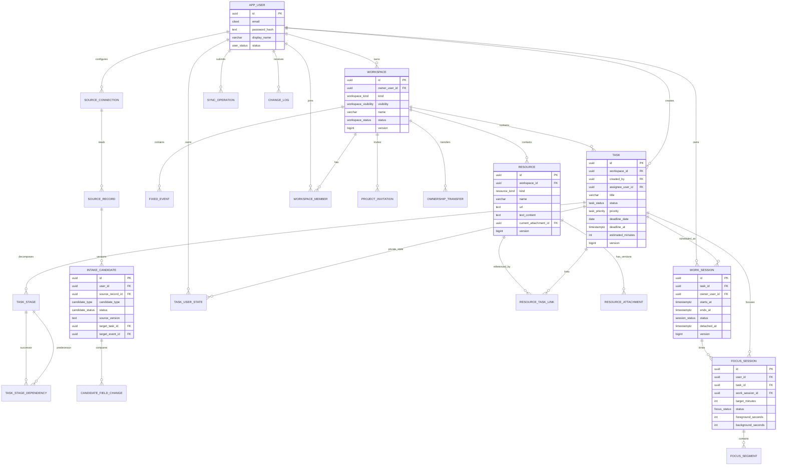

# KaiXu 数据库设计

> 数据库：PostgreSQL 16  
> 完整可执行 DDL：[schema.sql](schema.sql)  
> 设计目标：共享数据可协作、私人数据可隔离、离线同步可重放、删除与权限变更可传播。

## 1 建模原则

1. **关系数据库优先**：工作区、任务、成员、权限、来源关系都是强关系数据；JSONB 只用于来源原始字段、共享快照和审计上下文，不把核心业务塞进 JSON。
2. **共享与私自分表/分列**：共享任务、事件、资料有独立表；私人工作时段、本人剩余估时、番茄钟片段使用 `owner_user_id` 或独立表，读取时强制按本人过滤。
3. **软删除 + tombstone**：任务、事件、资料使用 `deleted_at`；同步用 `tombstone` 传播删除，避免硬删除破坏历史与他人脱链记录。
4. **版本列**：所有可并发编辑的实体有 `version bigint`，由触发器递增；客户端提交 `baseVersion`，服务端 `WHERE version = ?` 更新。
5. **稳定 ID**：应用生成 UUIDv7，按时间大致有序，便于索引与分页；`operationId` 也是 UUIDv7。
6. **时间分开**：`deadline_date` 与 `deadline_at` 互斥；`starts_at`/`ends_at` 使用 `timestamptz`；业务时区固定 `Asia/Shanghai`。
7. **日期精度不伪造**：只有日期的截止不写入人为的 23:59；过期判断由应用在 Asia/Shanghai 当日结束后处理。
8. **数据库约束只做“绝不能错”的规则**：跨表权限、成员资格、状态机由应用服务保证；能用唯一索引/检查约束兜底的必须兜底。

## 2 核心 ER 图



## 3 表目录

| # | 表 | 用途 | 关键约束/索引 |
| --- | --- | --- | --- |
| 1 | `app_user` | 账号、密码哈希、状态 | email 唯一；密码哈希非空 |
| 2 | `user_settings` | 时区、周起始日、默认番茄钟 | 1:1 用户 |
| 3 | `device` | 桌面/Android 设备 | `(user_id,last_seen_at)` |
| 4 | `refresh_session` | 刷新令牌、旋转链、撤销 | token_hash 唯一；expires_at |
| 5 | `workspace` | 课程/项目、可见性、归档、共享确认 | owner+status+kind；课程不可共享；共享必须已确认 |
| 6 | `workspace_member` | 项目成员与角色 | 活跃成员唯一；每项目唯一活跃 OWNER |
| 7 | `project_invitation` | 单次邀请 | token_hash 唯一；7 天过期由应用设置；已接受/撤销互斥 |
| 8 | `ownership_transfer` | 所有权交接 | 每项目唯一 PENDING |
| 9 | `workspace_share_snapshot` | 共享范围快照 | workspace + created_at |
| 10 | `task` | 任务、截止、估时、负责人、软删除 | workspace+status；creator/assignee；deadline；标题 trgm |
| 11 | `task_stage` | 任务阶段、顺序、阶段估时 | `(task_id, sort_order)` 可延迟唯一 |
| 12 | `task_stage_dependency` | 阶段依赖 | 同任务、无自依赖（触发器） |
| 13 | `task_user_state` | 本人剩余估时（私有） | PK `(task_id,user_id)` |
| 14 | `fixed_event` | 固定事件、重复规则 | owner/workspace + 时间；ends > starts |
| 15 | `work_session` | 本人工作时段（私有） | owner+time；task+time；脱链时间一致性 |
| 16 | `resource` | 链接/文本/附件元数据 | workspace+updated；名称 trgm；类型字段检查 |
| 17 | `resource_attachment` | 附件版本 | `(resource_id,version_no)` 唯一；每资源唯一 current；≤20MB |
| 18 | `resource_task_link` | 任务—资料引用 | 同工作区（触发器）；复合主键 |
| 19 | `source_connection` | 外部来源连接、范围、状态 | 用户+来源+外部账号唯一 |
| 20 | `source_credential` | 第三方凭据密文 | 1:1 连接；AES-GCM 密文/随机数 |
| 21 | `source_record` | 来源记录身份与最近内容 | 用户+来源+账号+记录 ID 唯一 |
| 22 | `intake_candidate` | 候选、版本、接受/忽略、目标 | 来源记录+版本唯一；每来源记录最多一个 ACCEPTED |
| 23 | `candidate_field_change` | 字段级变更比较 | `(candidate_id,field_name)` 唯一 |
| 24 | `focus_session` | 番茄钟会话（私有） | 每用户唯一运行中；目标分钟；前后台秒数 |
| 25 | `focus_segment` | 前台/后台时间片 | 同会话时间片不重叠（排他约束） |
| 26 | `sync_operation` | 桌面操作幂等日志 | operationId 主键；payload_hash |
| 27 | `change_log` | 按用户扇出的变更游标 | `(user_id,seq)` |
| 28 | `tombstone` | 删除传播 | `(entity_type,entity_id)` |
| 29 | `idempotency_key` | 在线专用 POST 幂等 | `(user_id,endpoint,key)` 唯一 |
| 30 | `audit_log` | 敏感动作审计 | actor/entity/workspace + 时间 |
| 31 | `outbox_event` | 异步集成/通知 | PENDING 部分索引 |
| 32 | `reminder` | 站内/邮件提醒 | PENDING + remind_at |

## 4 核心表结构

> 下列为主要字段与约束；完整列、默认值、外键和索引见 [schema.sql](schema.sql)。命名使用 `snake_case`，API 使用 `camelCase`。

### 4.1 `workspace` 工作区

| 列 | 类型 | 空 | 默认 | 说明 |
| --- | --- | --- | --- | --- |
| `id` | uuid | 否 | app UUIDv7 | 主键 |
| `owner_user_id` | uuid | 否 | — | 所有者；项目共享后仍为唯一 owner |
| `kind` | workspace_kind | 否 | — | `COURSE` / `PROJECT` |
| `visibility` | workspace_visibility | 否 | `PERSONAL` | 课程必须 PERSONAL；项目可 SHARED |
| `name` | varchar(120) | 否 | — | 去空白后非空 |
| `description` | text | 否 | `''` | 简介 |
| `linked_course_id` | uuid | 是 | null | 项目关联课程；不可自指；课程不可关联课程 |
| `status` | workspace_status | 否 | `ACTIVE` | 归档后只读 |
| `sharing_confirmed_at/by` | timestamptz/uuid | 是 | null | 首次共享确认；SHARED 时必填 |
| `version` | bigint | 否 | 1 | 乐观锁 |
| `created_by/created_at/updated_at/archived_at` | — | — | — | 审计与生命周期 |

约束：`kind='COURSE' ⇒ visibility='PERSONAL'`；`linked_course_id` 只能指向 `COURSE` 且不能等于自身；`status='ARCHIVED' ⇔ archived_at IS NOT NULL`。

**所有者一致性**：创建项目时，服务端在同一事务写入 `workspace.owner_user_id` 和一条 `workspace_member(role='OWNER', status='ACTIVE')`。所有权交接时两者在同一事务更新；`uq_workspace_one_active_owner` 兜底“恰一活跃 owner”。

### 4.2 `task` 任务

| 列 | 类型 | 空 | 说明 |
| --- | --- | --- | --- |
| `id` | uuid | 否 | 主键 |
| `workspace_id` | uuid | 是 | null = 独立任务；创建后不可变更 |
| `created_by` | uuid | 否 | 创建者 |
| `assignee_user_id` | uuid | 是 | 共享项目负责人；必须为活跃成员（服务校验） |
| `title` | varchar(200) | 否 | 必填，去空白非空 |
| `description` | text | 否 | 默认空 |
| `status` | task_status | 否 | `TODO` / `IN_PROGRESS` / `COMPLETED` |
| `priority` | task_priority | 否 | 默认 `MEDIUM` |
| `deadline_date` | date | 是 | 仅日期截止 |
| `deadline_at` | timestamptz | 是 | 具体时刻截止；与 date 互斥 |
| `estimated_minutes` | integer | 是 | 任务总估时，1–100000 |
| `blocked_note` | text | 是 | 共享阻碍说明 |
| `version` | bigint | 否 | 乐观锁 |
| `last_modified_by` | uuid | 是 | 最后编辑者 |
| `completed_at` | timestamptz | 是 | 与 status 一致 |
| `deleted_at/by` | timestamptz/uuid | 是 | 软删除；配合 tombstone |

约束：截止日期/时刻至多一个；完成状态与 `completed_at` 双向一致；工作区不可变触发器；标题/截止/工作区组合索引。

### 4.3 `task_stage` 与 `task_stage_dependency`

| 表 | 关键列 | 说明 |
| --- | --- | --- |
| `task_stage` | `task_id`、`name`、`goal`、`sort_order`、`estimated_minutes`、`status`、`version` | 阶段从属一个任务；阶段不是时间段；阶段完成不自动完成父任务 |
| `task_stage_dependency` | `task_id`、`predecessor_stage_id`、`successor_stage_id` | 触发器校验同任务、非自依赖；应用层校验无环 |

阶段总估时与任务总估时不强制相等；不一致时界面提示用户核对（UC06.7 / UC13.2ai）。

### 4.4 `work_session` 工作时段（私有）

| 列 | 类型 | 说明 |
| --- | --- | --- |
| `id` | uuid | 主键 |
| `task_id` | uuid | 关联任务；任务删除后置 null |
| `owner_user_id` | uuid | 唯一可见者；共享接口永不返回 |
| `starts_at` / `ends_at` | timestamptz | 半开区间 `[start,end)`；ends > starts |
| `note` | text | 本人说明；脱链后保留 |
| `status` | session_status | `PLANNED` / `COMPLETED` / `CANCELLED` |
| `is_locked` | boolean | 规则排程重生成时保留 |
| `origin` | varchar(24) | `MANUAL` / `SCHEDULING_DRAFT` / `MIGRATED` |
| `overlap_confirmed` | boolean | 用户明确确认保留重叠 |
| `detached_at` | timestamptz | 任务删除后脱链时间；与 task_id 同时为空/非空 |
| `version` | bigint | 乐观锁 |

说明：不在数据库上禁止重叠，因为 FR-S05 允许用户明确确认保留重叠；应用层以 `[)` 检查并记录 `overlap_confirmed`。

### 4.5 `resource` 与附件版本

| 表 | 关键列 | 说明 |
| --- | --- | --- |
| `resource` | `workspace_id`、`name`、`description`、`kind`、`url`、`text_content`、`current_attachment_id`、`version` | `LINK` 必须有 http(s) URL；`TEXT` 必须有文本；`ATTACHMENT` 允许先建记录后上传 |
| `resource_attachment` | `resource_id`、`version_no`、`object_key`、`file_name`、`content_type`、`size_bytes`、`sha256`、`uploader_user_id`、`is_current` | 单文件 ≤20MB；版本号唯一；每资源唯一 current；上传完整后才切换 |
| `resource_task_link` | `task_id`、`resource_id`、`created_by` | 触发器保证同一工作区；删除链接不删除资料 |

附件内容存对象存储，数据库只存元数据；`sha256` 用于完整性校验；旧版本永久保留（或按保留策略归档）。

### 4.6 `intake_candidate` 与来源

| 表 | 关键列 | 说明 |
| --- | --- | --- |
| `source_connection` | `user_id`、`source_type`、`status`、`external_account_id`、`scope` | 可暂停/撤销；撤销后停止新读取 |
| `source_credential` | `ciphertext`、`nonce`、`key_version` | 第三方凭据信封加密；不进入业务响应/日志 |
| `source_record` | `user_id`、`source_type`、`external_account_id`、`external_record_id`、`status`、`last_payload` | 唯一键定义 FR-I04 的来源身份 |
| `intake_candidate` | `source_record_id`、`candidate_type`、`status`、`source_version`、`title`、`original_text`、`fields`、`target_task_id/event_id` | 来源记录+版本唯一；每来源记录最多一个 ACCEPTED |
| `candidate_field_change` | `candidate_id`、`field_name`、`old_source_value`、`local_value`、`new_source_value`、`decision` | 字段级三方比较；接受才更新 |

候选生命周期：`PENDING → ACCEPTED / IGNORED / SUPERSEDED / NEEDS_REVIEW`。忽略同一版本后不再提示；后续新版本可再成为候选。手工粘贴没有可靠来源 ID 时 `source_record_id` 为空，走疑似重复审核而不是唯一键保证。

### 4.7 `focus_session` 与 `focus_segment`（私有）

| 表 | 关键列 | 说明 |
| --- | --- | --- |
| `focus_session` | `client_session_id`、`user_id`、`task_id`、`work_session_id`、`target_minutes`、`status`、`result`、`foreground_seconds`、`background_seconds`、`effective_seconds` | 每用户同时只有一个 ACTIVE/PAUSED；目标分钟固定后不能调小追认 |
| `focus_segment` | `session_id`、`client_segment_id`、`kind`、`started_at`、`ends_at`、`duration_seconds` | 同会话时间片不重叠；前台/后台互斥；断网不补算 |

达标规则 `effective_seconds >= 0.70 × target_minutes × 60` 由应用计算；数据库只存事实。番茄钟结果不改变任务状态，也不进入共享项目进度。

### 4.8 同步相关表

| 表 | 作用 | 关键点 |
| --- | --- | --- |
| `sync_operation` | 每个桌面操作的服务端幂等记录 | `id` = 客户端 `operationId`；`payload_hash` 防止同 ID 不同内容 |
| `change_log` | 按接收用户扇出的增量 | `seq` 作为游标；共享变更给每个活跃成员写一行 |
| `tombstone` | 删除传播 | 客户端据此删除本地实体或脱链私人记录 |
| `idempotency_key` | 在线专用 POST 的 `Idempotency-Key` | 与 sync 分开；用于完成、候选接受、邀请、附件完成等 |
| `audit_log` | 审计 | 只写脱敏上下文，不写原文/令牌/Key |

## 5 隐私分区

| 数据 | 本人可见 | 项目成员可见 | 服务端日志 | 说明 |
| --- | --- | --- | --- | --- |
| 任务标题/描述/状态/优先级/截止/总估时 | 是 | 是（项目任务） | 仅 ID/动作 | 共享任务字段 |
| 负责人/阻碍说明/最后编辑人/时间 | 是 | 是 | 仅 ID/动作 | 项目进度 |
| `task_user_state.remaining_minutes` | 是 | **否** | 否 | 本人剩余估时 |
| `work_session` 全部字段 | 是 | **否** | 否 | 私人执行时间 |
| `focus_session`/`focus_segment` | 是 | **否** | 否 | 番茄钟明细 |
| 资源名称/描述/URL/文本/当前附件 | 是 | 是（项目资源） | 仅 ID/动作 | 共享资料 |
| 附件下载 | 有权限时 | 有权限时 | 仅 ID/结果 | 每次下载鉴权 |
| 课程名称/描述 | 有课程权限时 | **否**（共享项目未共享课程） | 否 | 仅返回“私人课程”占位 |
| 来源原文/来源链接 | 是 | 共享任务确认范围内可见 | 否（日志不写原文） | 来源快照 |
| 第三方凭据/AI Key | 本机/加密存储 | **否** | **否** | 不进入业务同步 |
| 密码/刷新令牌 | 否 | 否 | 否 | 仅哈希/密文 |

## 6 业务规则与数据库映射

| 规则 | 数据库/应用落实 |
| --- | --- |
| BR01 任务/事件至多一个工作区 | 单列 `workspace_id` + FK；无多对多归属表 |
| BR02 截止与执行分开；半开区间 | `deadline_*` 与 `work_session.starts_at/ends_at` 分离；应用用 `[start,end)` 判重叠，相邻不算重叠 |
| BR03 完成任务移出排程池 | 查询 `status <> 'COMPLETED'`；完成事务同时处理本人未来时段 |
| BR04 来源唯一 | `source_record` 唯一键 + `intake_candidate` 接受唯一索引 |
| BR05 来源更新不覆盖本地 | `candidate_field_change` 三方值；接受字段才写任务 |
| BR06 共享需确认；私人时段不共享 | `workspace.share_snapshot` + 共享读模型不查询 `work_session` |
| BR07 每项目恰一 owner | `uq_workspace_one_active_owner` 部分唯一索引 |
| BR08 邀请 7 天、单次 | `expires_at`、`accepted_at`/`revoked_at`、token_hash 唯一 |
| BR09 共享记录权限 + 版本 | 服务端 policy + `version` 列 + `sync_operation` |
| BR10 资料链接同工作区 | `check_resource_task_link_workspace` 触发器 |
| BR11 归档只读 | `workspace.status` + 应用拒绝写；本人已有时段仍可调整 |
| BR12 失权只保留时间与本人说明 | 成员状态 + 脱链服务；删除共享标题/来源/资料访问 |
| BR13 Asia/Shanghai；日期精度 | `timestamptz` + `timezone` + 应用规则；日期列不补时间 |
| BR14 双端同一状态/规则 | 共享 Kotlin 枚举/校验 + 同一契约样本 |
| BR15 删除任务不级联删除他人时段 | 软删 + 本人 `work_session` 脱链；tombstone 传播 |

## 7 索引与查询设计

### 7.1 主要查询

| 查询 | 索引 |
| --- | --- |
| 今日/周视图：本人事件 + 本人时段 | `idx_fixed_event_owner_time`、`idx_work_session_owner_time` |
| 工作区任务列表/筛选 | `idx_task_workspace_status` |
| 我的任务/负责人任务 | `idx_task_creator_status`、`idx_task_assignee_status` |
| 截止提醒 | `idx_task_deadline` |
| 任务/资料搜索 | `idx_task_title_trgm`、`idx_resource_name_trgm` |
| 资料列表 | `idx_resource_workspace` |
| 来源候选 | `idx_intake_candidate_user_status` |
| 同步拉取 | `idx_change_log_user_seq` |
| 番茄钟历史 | `idx_focus_session_user_time` |
| 审计检索 | `idx_audit_log_actor_time`、`idx_audit_log_workspace` |

### 7.2 性能注意事项

- 周视图只查 `[weekStart, weekEnd)`，不拉全表；分页默认 50，最大 200。
- 共享项目任务列表先按 `workspace_id` 过滤，再按状态/截止；避免对 `change_log` 做全表扫描。
- `change_log` 定期归档：保留最近 90 天；客户端 cursor 过旧时返回 `SYNC_CURSOR_EXPIRED`，要求全量重拉。
- `audit_log` 按月分区或定期归档（课程环境可先普通表 + 索引）。
- 模糊搜索使用 `pg_trgm`，限制最小查询长度 2，避免全表低选择性扫描。
- 不在事务内调用外部来源或对象存储；附件预签名/上传在事务外完成，完成回调再切换 current 指针。

## 8 迁移、备份与保留

### 8.1 迁移

- 使用 Alembic，迁移文件与 schema 一一对应；每个迁移必须有升级路径和回滚说明。
- 只允许向前迁移；生产回滚用备份恢复，不执行破坏性 down。
- 迁移前自动备份；迁移脚本在空库和上一版本快照上各跑一次。
- 大表加列使用可空列 + 回填 + 约束分步；避免长时间锁表。

### 8.2 备份与恢复

| 项 | 策略 |
| --- | --- |
| 全量备份 | 每日一次，保留 14 天；验收环境至少保留 7 天 |
| WAL 归档 | 生产开启；RPO ≤ 24h，RTO ≤ 4h（NFR-R05） |
| 对象存储 | 版本化 + 生命周期；附件元数据与对象键一致 |
| 恢复演练 | 验收前恢复一次，核对任务、附件版本、权限、资料关系；备份后的撤权重新对账 |
| 加密 | 备份加密存储；恢复环境访问受控 |

### 8.3 数据保留

| 数据 | 保留策略 |
| --- | --- |
| 活跃业务数据 | 账号存续期间 |
| 软删除任务/事件/资料 | 保留 90 天供同步与恢复，之后归档/清理 |
| `tombstone` | 至少 90 天，覆盖离线客户端最长离线周期 |
| `change_log` | 90 天；过期 cursor 触发全量重拉 |
| `audit_log` | 180 天（课程环境可缩短），敏感字段脱敏 |
| 附件旧版本 | 随资料存续；删除资料后按保留策略清理对象 |
| 已注销账号 | 30 天冷静期后删除/匿名化；共享历史保留必要审计 |

## 9 DDL 使用说明

```bash
# 空库执行（示例）
createdb kaixu
psql -d kaixu -v ON_ERROR_STOP=1 -f docs/03-design/system-design/schema.sql
```

- 脚本假设空库；重复执行会因类型/表已存在而失败。
- 生产环境通过 Alembic 管理，不直接执行本脚本。
- 应用生成的 UUIDv7 通过 `id` 显式写入；`gen_random_uuid()` 仅作数据库兜底。
- 若数据库未安装 `pg_trgm`/`btree_gist` 扩展，需先由 DBA 安装 contrib 包。

### 9.1 当前验证记录

本设计基线已在 PostgreSQL 16.15 空库执行通过，并用 [schema-smoke-test.sql](schema-smoke-test.sql) 的样例数据验证以下约束：

- 同项目第二个活跃 OWNER 被唯一索引拒绝；
- 跨工作区任务—资料关联被触发器拒绝；
- 任务创建工作区后再改归属被触发器拒绝；
- 同一来源记录接受第二个候选被部分唯一索引拒绝；
- 同一用户并发启动第二个番茄钟被部分唯一索引拒绝；
- 同一番茄钟会话的时间片重叠被排他约束拒绝；
- 资源 current 附件指向其他资源被触发器拒绝；
- 跨任务阶段依赖被触发器拒绝。

执行命令与样例见本节；正式项目仍应将这些检查纳入后端集成测试，而不是只依赖手工冒烟。

## 10 数据库验收清单

- [ ] 空库执行 `schema.sql` 无错误；所有外键、检查约束、触发器生效。
- [ ] 同一项目并发插入两个活跃 OWNER 被唯一索引拒绝。
- [ ] 同一来源记录接受两次只有一个 `ACCEPTED`。
- [ ] 跨工作区关联任务与资料被触发器拒绝。
- [ ] 任务更新工作区被触发器拒绝。
- [ ] 阶段依赖跨任务/自依赖被触发器拒绝。
- [ ] 同一用户并发启动两个番茄钟被部分唯一索引拒绝。
- [ ] 同一会话时间片重叠被排他约束拒绝。
- [ ] 删除任务后本人时段可脱链，他人时段不受影响。
- [ ] 共享项目查询不返回 `work_session`、`task_user_state`、`focus_*`。
- [ ] 附件超过 20MB 被检查约束拒绝；失败上传不切换 current。
- [ ] 恢复备份后任务、附件版本、成员权限、资料链接一致。
