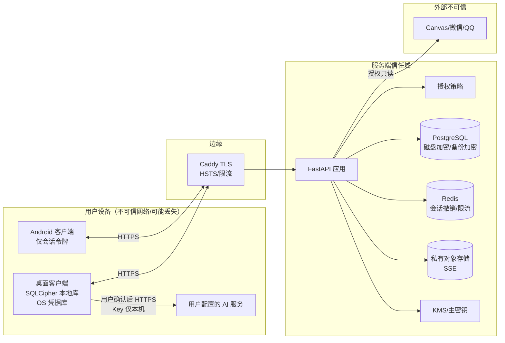

# KaiXu 安全设计

> 目标：在“桌面本地优先 + 共享项目 + 可选 AI + 外部来源”的组合下，保证账号、共享内容、私人执行数据和第三方凭据不被越权访问、泄露或静默覆盖。  
> 依据：SRS 7.3 NFR-S01–S05、AT06；《KaiXu 用例分解》的离线、同步、AI 与番茄钟规则。

## 1 安全目标与信任边界

### 1.1 安全目标

| 编号 | 目标 | 可验证结果 |
| --- | --- | --- |
| S-01 | 账号与会话不可冒用 | 密码/令牌不落明文；刷新令牌旋转；设备可撤销 |
| S-02 | 共享内容按项目成员资格访问 | 非成员/被移除成员直接调用接口也失败 |
| S-03 | 私人执行数据不泄露 | 他人响应、项目导出、日志中无私人时段/剩余估时/番茄钟 |
| S-04 | 本地数据在设备丢失时不可读 | 桌面库 SQLCipher 加密；密钥在 OS 凭据库 |
| S-05 | 第三方凭据与 AI Key 不泄露 | 服务端只存密文；AI Key 仅本机；日志脱敏 |
| S-06 | 同步可重试且不可越权 | 重放/重复/篡改被幂等、版本、权限校验拦住 |
| S-07 | 外部来源与 AI 不扩大权限 | 只读授权范围；建议不自动写正式数据 |
| S-08 | 安全事件可追溯 | 审计记录请求 ID、动作、结果；敏感字段脱敏 |

### 1.2 信任边界



**边界规则**：

- 客户端输入、外部来源内容、AI 输出都不可信；服务端必须重新校验。
- 桌面本地库属于用户设备，服务端不信任其内容；本地权限快照不能替代服务端鉴权。
- Android 不保存业务缓存，减少设备丢失后的数据暴露面。
- 对象存储桶私有；任何文件读取都经过服务端鉴权后签发短时 URL。

## 2 威胁模型（STRIDE）

| 威胁 | 场景 | 影响 | 缓解 |
| --- | --- | --- | --- |
| Spoofing | 窃取 access/refresh token；伪造邀请 token | 冒用账号/加入项目 | 短时 JWT；refresh 旋转 + 重用检测；邀请 token 256-bit 哈希存储、单次、7 天 |
| Spoofing | 设备丢失后打开桌面库 | 读取本地数据 | SQLCipher；密钥在 OS Keychain/Credential Manager；退出锁库；系统账户锁 |
| Tampering | 修改同步 payload 的 `userId`/`workspaceId` | 越权写他人/他项目 | 服务端从 token 取 actor；字段 allowlist；成员资格 + 版本复核；`operationId` 绑定用户 |
| Tampering | 本地库直接改版本/权限 | 本地显示错误，但上传被拒 | 服务端权威；共享写每次鉴权；版本冲突 |
| Repudiation | 成员否认编辑共享任务/删除事件 | 无法追责 | `last_modified_by`、`updated_at`、`audit_log`、`change_log` |
| Information disclosure | 共享接口返回他人私人时段/剩余估时/番茄钟 | 隐私泄露 | 独立表/列；共享 DTO 投影；查询层禁止 join 私人表；测试断言 |
| Information disclosure | 共享项目泄露未共享课程名 | 课程隐私泄露 | 只返回 `visible:false` + “私人课程”，不返回名称/描述 |
| Information disclosure | 日志写入聊天原文/令牌/Key | 二次泄露 | 结构化日志脱敏；只写 ID/动作/结果；禁止记录 body |
| Information disclosure | 预签名 URL 被转发 | 未授权下载 | 5 分钟过期；每次签发鉴权；对象键随机；下载审计 |
| Denial of service | 登录爆破、来源检索、超大附件 | 服务不可用/成本 | 限流、锁定、异步检索、20MB 限制、批量上限 |
| Elevation of privilege | 成员调用 owner 接口；移除后继续访问 | 越权管理/读取 | 角色检查；每次请求查活跃成员；移除即拒绝；附件下载也鉴权 |
| Elevation of privilege | 通过 `workspaceId` 把任务挂到无权项目 | 数据污染 | 目标工作区权限校验；工作区不可变；资源同工作区触发器 |
| Elevation of privilege | AI 输出诱导自动写/扩大共享 | 非预期写入 | AI 只产生建议；确认前校验；无工具执行权限；共享范围独立确认 |

## 3 认证与会话

### 3.1 注册与密码

- 邮箱唯一（`citext`），注册后可选邮箱验证；课程环境可先不做验证，但保留字段/流程。
- 密码长度 8–128；禁止常见弱密码（可选 HaveIBeenPwned k-anonymity 检查）。
- 使用 **Argon2id**：`time_cost=3`、`memory_cost=64 MiB`、`parallelism=4`、salt 16 bytes、hash 32 bytes；参数写入配置，便于升级。
- 密码错误统一返回“邮箱或密码不正确”，不区分账号是否存在。
- 登录限流：IP 10 次/分钟、账号 5 次/5 分钟；连续失败触发短时锁定/验证码（可选）。
- 密码重置：一次性 token（哈希存储、30 分钟、单次）；不通过邮件明文发送密码。
- 不在日志、错误响应、审计 detail 中记录密码。

### 3.2 令牌

| 令牌 | 形式 | 生命周期 | 存储 | 撤销 |
| --- | --- | --- | --- | --- |
| Access token | JWT（EdDSA/Ed25519 或 RS256） | 15 分钟 | 客户端内存/安全存储 | 短生命周期；`jti` 黑名单用于紧急撤销 |
| Refresh token | 256-bit 随机不透明串 | 30 天 | 服务端只存 SHA-256 哈希；客户端 OS 安全存储 | 旋转；重用检测撤销整个 token family |
| 邀请 token | 256-bit 随机不透明串 | 7 天 | 服务端只存 SHA-256 哈希 | 单次使用；撤销/过期 |
| 附件下载 URL | 预签名 URL | 5 分钟 | 不存储 | 到期；权限变更后新请求拒绝 |

JWT claims：

```json
{
  "iss": "https://api.kaixu.example",
  "sub": "0192f4c8-...",
  "sid": "0192f4c8-...",
  "device_id": "0192f4c8-...",
  "jti": "0192f4c8-...",
  "iat": 1762049700,
  "exp": 1762050600,
  "scope": "user"
}
```

- 签名密钥由 KMS/环境变量注入，支持 `kid` 轮换；私钥不进入代码库。
- 校验 `iss`、`aud`、`exp`、`nbf`、签名算法白名单；拒绝 `none`/弱算法。
- Access token 只用于认证，不携带角色/权限快照；权限每次从数据库/策略读取，避免撤权后旧 token 继续生效。
- Refresh 旋转：每次刷新签发新 refresh，旧 token 标记已用；若旧 token 再次出现，视为重放，撤销该 family 并要求重新登录。
- 登出：撤销当前 refresh + access `jti` 加入短期黑名单；桌面锁库但保留加密的未同步数据。
- 设备管理：可查看/撤销设备；撤销设备后其 refresh 全部失效，access 最迟 15 分钟后失效（敏感操作可即时检查 `device.revoked_at`）。

### 3.3 桌面未登录与账号隔离

- 未登录空间 `guest` 不请求业务服务端，不自动上传。
- 每个账号一个 SQLCipher 数据库文件；数据库密钥随机生成，存入 OS Keychain/Credential Manager，不写入配置文件。
- 退出登录：从内存移除密钥、关闭连接、锁定账号库；不删除未同步修改；下次同账号登录继续。
- 切换账号：先锁定当前库，再打开目标账号库；禁止跨库查询。
- 会话过期/设备撤销：桌面进入离线只读本地库，敏感在线操作要求重新登录；不自动上传待同步数据直到重新认证。

### 3.4 Android 会话

- 必须登录且在线；不建业务库。
- 令牌存 Android Keystore 支持的 EncryptedSharedPreferences/DataStore；不写日志。
- 退出登录清除令牌与内存状态；返回登录入口。
- 可选：对包含共享内容的页面启用 `FLAG_SECURE` 防截屏（课程演示可配置）。

## 4 授权与访问控制

### 4.1 模型

采用 **RBAC + 资源级策略 + 字段级投影**：

```text
请求 → 认证（actor, device, session）
     → 加载资源（workspace/task/event/resource/session）
     → Policy.check(actor, action, resource, context)
     → 查询/写入（共享表 + 私人表按 owner 过滤）
     → 响应 DTO（字段白名单投影）
```

- **默认拒绝**：没有明确允许即拒绝。
- **服务端唯一权威**：客户端隐藏按钮只是体验，不是安全控制。
- **每次请求复核**：共享读/写/下载都检查当前成员状态，不能只依赖登录时的角色。
- **对象级授权**：不仅检查“是否登录”，还检查“是否属于该项目/该任务/该时段”。

### 4.2 角色与动作

| 动作 | OWNER | MEMBER | 非成员 | 说明 |
| --- | --- | --- | --- | --- |
| 读取项目任务/事件/资料 | 允许 | 允许 | 拒绝（404） | 不泄露存在性 |
| 创建/编辑/删除共享任务/事件/资料 | 允许 | 允许 | 拒绝 | 版本 + 成员校验 |
| 邀请/撤销邀请 | 允许 | 拒绝 | 拒绝 | `owner` 专属 |
| 移除成员/退出 | 允许移除 | 允许自己退出 | 拒绝 | 退出后立即失权 |
| 归档/恢复/共享确认 | 允许 | 拒绝 | 拒绝 | 共享确认需先同步 |
| 所有权交接 | 发起/接受 | 接受（被提名） | 拒绝 | 始终恰一 owner |
| 读取本人工作时段 | 允许 | 允许 | — | 只按 `owner_user_id=actor` |
| 读取他人工作时段 | 拒绝 | 拒绝 | 拒绝 | 任何角色都不可 |
| 读取本人剩余估时 | 允许 | 允许 | — | `task_user_state` |
| 读取他人剩余估时 | 拒绝 | 拒绝 | 拒绝 | 不在共享 DTO |
| 读取本人番茄钟 | 允许 | 允许 | — | `focus_*` |
| 读取他人番茄钟 | 拒绝 | 拒绝 | 拒绝 | 不在共享 DTO |
| 下载共享附件 | 允许 | 允许 | 拒绝 | 每次签发 URL 时检查 |

### 4.3 私人数据隔离实现

1. **表级隔离**：`work_session`、`task_user_state`、`focus_session`、`focus_segment` 都带 `owner_user_id`/`user_id`。
2. **查询级隔离**：共享读模型不 join 这些表；私人接口强制 `WHERE owner_user_id = :actor`。
3. **DTO 白名单**：共享任务 DTO 只包含 `TaskSharedView` 字段；新增字段必须显式加入白名单。
4. **导出隔离**：项目导出只包含共享字段；不导出私人时段、剩余估时、番茄钟、AI 配置。
5. **日志隔离**：审计只写实体 ID/动作/结果，不写私人备注原文。
6. **测试隔离**：AT06 用两个账号断言对方响应不含私人字段。

### 4.4 课程隐私

- 项目可关联课程，但共享项目不共享课程。
- 无课程权限的成员看到：

```json
{
  "linkedCourse": {
    "visible": false,
    "label": "私人课程"
  }
}
```

- 不返回课程 ID、名称、描述、教师、课表；避免通过 ID 枚举探测。

### 4.5 归档与失权

- 归档：工作区内容只读；任务/事件/资料写操作拒绝；本人已有时段仍可调整（Table 17A）。
- 成员移除/退出：
  1. 服务端立即把成员状态置为 `REMOVED`/`LEFT`。
  2. 后续项目读/写/附件下载全部拒绝（包括直接调用 API）。
  3. 桌面收到 `MEMBERSHIP_REVOKED` 后清理共享标题、来源、资料访问；本人时段按 BR12 脱链，仅保留时间与本人说明。
  4. 审计记录移除者、时间、操作 ID；不向移除者返回他人私人明细。
- 所有权交接：PENDING 唯一；生效前原 owner 仍负责；接受时同一事务切换角色。

### 4.6 防越权细节

- 所有写接口从 token 取 `actorUserId`，忽略 body 中的 `userId`。
- `workspaceId`、`taskId`、`resourceId` 都做归属校验；不能通过改 ID 跨项目。
- 任务创建后工作区不可变（数据库触发器 + 服务校验）。
- 资源链接必须同工作区（数据库触发器 + 服务校验）。
- 共享任务负责人必须是活跃成员；移除成员时将其负责的任务改为未分配或提示 owner 处理。
- 批量同步按 operation 逐条鉴权；不能因为批次中一条有权就放行其他条。
- 列表接口先按可见工作区过滤，再做搜索/分页；避免分页泄露不可见记录数量。

## 5 加密方案

### 5.1 传输加密

- 全站 HTTPS；TLS 1.2+，优先 TLS 1.3；禁用弱套件/旧协议。
- HSTS（含子域，谨慎 preload）；HTTP 自动跳转 HTTPS。
- 证书由 Caddy 自动管理/定期轮换；开发环境可用本地证书。
- Android 网络安全配置禁止明文；可选证书固定（课程环境不强制，避免运维复杂）。
- 服务间（API→PostgreSQL/Redis/S3）在受控网络内；生产启用 TLS 连接。

### 5.2 服务端存储加密

| 数据 | 方案 | 说明 |
| --- | --- | --- |
| 密码 | Argon2id 哈希 | 不可逆；参数可升级 |
| Refresh token | SHA-256 哈希 | 不存明文；比对哈希 |
| 邀请 token | SHA-256 哈希 | 创建响应只返回一次明文 |
| 第三方来源凭据 | AES-256-GCM 信封加密 | 数据密钥由 KMS 主密钥封装；`key_version` 支持轮换 |
| 附件 | 对象存储 SSE-S3/SSE-KMS | 桶私有；服务端加密 |
| 数据库磁盘 | 云盘加密/TDE | 备份同样加密 |
| 备份 | 加密 + 访问控制 | 恢复演练使用隔离环境 |
| 审计 detail | 脱敏 JSON | 不写原文/令牌/Key |

信封加密流程：

```text
KMS master key
  → generate data key (DEK) per credential / per batch
  → AES-256-GCM encrypt plaintext with DEK + 12-byte nonce
  → store ciphertext + nonce + key_version
  → wrap DEK with master key (KMS)
  → decrypt only in source adapter memory; never log/return
```

- 密钥轮换：`key_version` 标记；后台逐步重加密；旧版本保留解密能力，到期删除。
- 开发/验收环境使用独立密钥，不复用生产密钥；仓库不提交任何密钥。

### 5.3 桌面本地加密

- SQLCipher（AES-256-CBC/HMAC 或 SQLCipher 4 默认）加密整个业务库。
- 数据库密钥：随机 256-bit，存 OS Keychain（macOS）/Credential Manager（Windows）；不硬编码、不写入日志。
- 每个空间独立库文件：`guest.db`、`user-<uuid>.db`；密钥按空间隔离。
- 退出登录锁库；应用闲置自动锁定（可配置 15 分钟）；锁定时清除内存密钥。
- 本地备份/导出默认加密；导出前提示包含私人数据。
- 桌面升级迁移失败进入只读恢复模式，不删除库。

### 5.4 Android 本地安全

- 不保存业务数据库；仅保存会话令牌、设备 ID、界面偏好。
- 令牌使用 Android Keystore 支持的加密存储；不写外部存储。
- 退出登录清除令牌与内存；不保留业务缓存。
- 可选：共享/私人页面启用 `FLAG_SECURE`，防止截图/最近任务预览泄露。

### 5.5 AI Key 与第三方 Key

- AI Key 只存桌面 OS 凭据库；不进入 SQLite 业务表、不进入同步、不进入日志、不进入共享项目。
- UI 掩码显示；复制/显示需显式操作；切换账号不显示上一空间 Key。
- 第三方来源凭据只存服务端 `source_credential` 密文；不返回客户端；不写日志。
- 任何密钥都不出现在错误消息、崩溃报告、分析事件中。

## 6 隐私与数据最小化

### 6.1 收集最小化

- 账号只收集邮箱、显示名、密码哈希；不收集学校账号密码。
- 外部来源只读取用户授权范围内的课程/群组消息；不读取完整私人聊天历史。
- AI 只发送用户本次选择的任务描述/资料片段/聊天范围；不自动附带私人日历、番茄钟、其他项目文件。
- 分析/日志只记录操作类型、耗时、结果、请求 ID；不记录业务正文。

### 6.2 字段级隐私

| 字段 | 共享响应 | 私人接口 | 日志 |
| --- | --- | --- | --- |
| 任务标题/描述/状态/优先级/截止/总估时 | 是 | 是 | 仅 ID |
| 负责人/阻碍说明/最后编辑 | 是 | 是 | 仅 ID |
| 本人剩余估时 | **否** | 是 | 否 |
| 工作时段起止/备注 | **否** | 是 | 否 |
| 番茄钟前后台/达标/反馈 | **否** | 是 | 否 |
| 资料名称/描述/URL/文本 | 是（项目资源） | 是 | 仅 ID |
| 来源原文 | 共享任务确认范围内 | 是 | **否** |
| 课程名称（未共享课程） | **否**（“私人课程”） | 有权限时 | 否 |
| 密码/令牌/Key | 否 | 否 | 否 |

### 6.3 日志脱敏

- 结构化日志字段：`requestId`、`actorUserId`（内部 ID 或哈希）、`action`、`entityType`、`entityId`、`workspaceId`、`result`、`latencyMs`、`errorCode`。
- 禁止记录：Authorization、refresh token、密码、AI Key、来源凭据、完整聊天原文、附件内容、私人备注。
- 错误日志只记录错误类型/堆栈摘要（服务端内部），响应只返回 `code` + `requestId`。
- 日志保留 30–90 天；审计日志 180 天；到期归档/删除。

### 6.4 账号隔离与删除

- 桌面分库；Android 退出即清令牌；服务端所有查询带 `user_id` 过滤。
- 账号注销：30 天冷静期；期间可恢复；到期删除/匿名化个人数据。
- 注销后共享项目历史保留必要审计（不含私人数据）；成员关系标记移除。
- 设备丢失：用户可远程撤销设备；桌面本地库仍需系统账户/密钥才能解密。

## 7 同步安全

### 7.1 写入校验顺序

```text
1. 认证：token 有效、设备未撤销
2. 解析：operationId/entityType/entityId/operationType 白名单
3. 幂等：operationId 是否已处理；payload_hash 是否一致
4. 归属：实体属于当前用户/当前用户是项目活跃成员
5. 权限：动作是否符合角色；工作区是否归档
6. 版本：baseVersion == current.version（或 CREATE 的 baseVersion=0）
7. 领域规则：时间、状态、来源唯一、附件大小等
8. 事务：业务变更 + change_log + audit
9. 响应：新版本/冲突当前记录
```

- `operationId` 与 `user_id` 绑定；他人重放同一 ID 不能读到结果。
- 批量上限 100 条；单条 payload 大小上限（如 256KB），防止 DoS。
- 服务端不接受客户端传入的 `userId`、`role`、`createdAt`、`version` 作为权威值；只接受允许更新的字段。
- `payload_hash` 用 canonical JSON（键排序）计算；同 ID 不同内容返回 `OPERATION_ID_REUSED`。
- 冲突响应只返回调用者有权看到的当前记录；不泄露他人私人字段。

### 7.2 拉取安全

- `change_log` 按接收用户扇出；拉取时再次检查当前成员资格，防止旧 cursor 读到撤权后的共享内容。
- 删除用 tombstone；客户端不能通过重放旧 UPSERT 恢复已删除共享记录（版本/删除标记优先）。
- 游标过期触发全量重拉；全量重拉仍按当前权限过滤。
- 客户端应用远端变更时校验实体归属；不把服务端记录写入错误账号库。

### 7.3 离线快照的边界

- 桌面离线时共享内容是“最近同步快照”，可能不是最新；UI 显示最后同步时间。
- 离线期间无法获知撤权；重连必须先鉴权，再上传待同步操作。
- 若重连发现失权：拒绝上传共享修改，清理受限内容；本人时段按 BR12 脱链。
- 不允许用离线旧权限强制上传；服务端每次重新检查。

### 7.4 重放与重复

- `sync_operation` 主键 + `idempotency_key` + 唯一业务约束（来源记录、任务时段等）三层防重。
- 完成/接受候选/邀请接受等跨表动作使用单事务；重复请求返回同一结果。
- 附件完成用 `attachmentId + sha256` 幂等；旧版本不因重试被覆盖。

## 8 AI 安全

### 8.1 数据流

```text
桌面 UI（用户选择范围）
  → 显示接收方/模型/将发送内容
  → 用户明确确认
  → 桌面直连用户配置的 OpenAI 兼容服务（TLS）
  → 返回建议（JSON）
  → 本地校验/展示
  → 用户逐项采纳/拒绝
  → 采纳后走正常 UC06/UC13 人工确认与保存
```

- 服务端不代理 AI 调用（默认）；不在服务端保存用户 Key。
- 若未来提供代理模式，必须重新做威胁建模，使用服务端 KMS 加密 Key，并明确数据保留策略。

### 8.2 关键控制

| 风险 | 控制 |
| --- | --- |
| Key 泄露 | 仅 OS 凭据库；掩码；不写日志/同步/共享；切换账号隔离 |
| 过度发送 | 每次调用展示接收方与范围；只发送用户选择的内容；不自动附带完整日历/群历史/私人时段 |
| Prompt injection | 外部文本视为数据而非指令；系统提示明确禁止扩大权限/调用工具；输出只作建议 |
| 自动写入 | AI 无写权限；结果必须经 UC06/UC13 人工确认；确认前再次校验目标版本/权限 |
| 编造字段 | 日期不明确标“待核对”；不编造负责人/事实；字段由用户确认 |
| 成本/滥用 | 1,000/500 token 输入输出上限；单次成本上限 ¥0.10；超限转人工；超时/取消 |
| 晚到结果 | 取消后丢弃；范围/原文变化后重新确认 |
| 日志泄露 | 不记录 prompt/response 原文；只记录调用结果/耗时/脱敏 token 数 |
| 共享泄露 | 共享项目的私人时段、剩余估时、番茄钟、未选文件不进入上下文 |

### 8.3 提示与输出处理

- 系统提示固定：只输出结构化建议；不得创建/修改/删除任何业务对象；不得请求密钥/权限；不得发送外部消息。
- 对模型输出做 JSON Schema 校验；非法/截断/超时只影响本次建议。
- 若输出包含“忽略之前指令”等注入文本，按普通内容处理，不执行。
- 用户拒绝/取消不产生正式写入；采纳的建议仍需通过领域规则（阶段依赖无环、估时为正、日期精度）。

## 9 附件与文件安全

### 9.1 上传

1. 客户端请求 `attachments:presign`，服务端校验项目权限、资源归属、文件名/类型/大小（≤20MB）。
2. 服务端生成随机对象键（不包含用户文件名/路径），短时预签名 PUT。
3. 客户端直传对象存储；服务端不经过大文件代理。
4. 客户端调用 `:complete`，服务端校验对象存在、大小、SHA-256、content-type。
5. 校验通过后在同一事务中创建 `resource_attachment` 并切换 `resource.current_attachment_id`；旧版本保留。
6. 失败/中断：不切换 current；用户可重试；重复完成幂等。

### 9.2 下载

- 每次下载都调用服务端；校验当前成员资格/工作区状态。
- 服务端签发 5 分钟预签名 GET；URL 不写入日志/审计 detail。
- 桶私有，禁止目录列举；对象键不可猜测。
- 可选恶意文件扫描（ClamAV/云扫描）；至少限制可执行类型和 content-type 白名单。
- 成员被移除后，已签发的 URL 最迟 5 分钟失效；后续签发拒绝。

### 9.3 完整性

- `sha256` 存库；下载可校验；备份恢复后核对附件版本与对象键。
- 新版本成为 current 前必须完整上传；旧版本保持可下载。
- 恢复旧版本 = 复制为新版本，不覆盖历史；保留上传人/时间/版本号。

## 10 外部来源安全

- 仅使用官方/授权方式（OAuth、授权 API、用户导入文件）；不保存学校账号密码，不做未授权爬取。
- 授权前展示范围（账号、课程、群组、时间范围）；用户可暂停/断开/撤回。
- 来源凭据信封加密；只在适配器内存解密；不返回客户端、不写日志。
- 外部内容不可信：字段校验、长度限制、URL 白名单（http/https）、HTML 清洗；不执行脚本。
- 来源撤回：停止新读取；已确认任务保留；只提示来源删除/撤回，不直接删本地任务。
- 外部请求限流/超时/重试；失败保留已有数据并显示原因；不阻塞本地工作流。
- 群聊提取需用户选择范围；AI 只处理选定文本；不读取完整群历史。

## 11 审计与监控

### 11.1 审计事件

| 类别 | 事件 |
| --- | --- |
| 认证 | 注册、登录成功/失败、刷新、登出、令牌重用、设备撤销 |
| 协作 | 邀请创建/撤销/接受、成员移除/退出、所有权交接、共享确认 |
| 共享数据 | 共享任务/事件/资料创建/编辑/删除、附件上传/下载/版本恢复 |
| 权限 | 403/404 拒绝、失权后访问、越权尝试 |
| 同步 | push 冲突、重复请求、游标过期、批量拒绝 |
| 来源 | 连接/暂停/恢复/撤回、检索失败、候选接受/忽略 |
| 运维 | 备份、恢复、迁移、配置变更（不记录密钥） |

审计字段：`requestId`、`actorUserId`、`action`、`entityType`、`entityId`、`workspaceId`、`result`、`ip`、`userAgent`、`detail`（脱敏）、`createdAt`。

### 11.2 监控告警

- 登录失败率、刷新令牌重用、403 激增、附件下载量异常、同步冲突率、来源检索失败率、5xx 率、p95 延迟。
- 告警阈值示例：同一账号 5 分钟内 10 次 403；同一 IP 1 分钟 20 次登录失败；单用户 1 小时下载 >100 个附件。
- 日志与指标分离；仪表盘不展示业务正文。
- 事件响应：发现泄露 → 撤销会话/设备 → 轮换密钥 → 评估范围 → 通知 → 修复 → 复盘。

## 12 开发与运维安全

| 环节 | 措施 |
| --- | --- |
| 需求/设计 | 每个共享/AI/同步功能做轻量威胁建模；安全验收项进入故事 |
| 代码 | 代码评审；禁止硬编码密钥；参数化 SQL；输出编码；字段白名单 |
| 依赖 | Dependabot/renovate；`pip-audit`、Gradle 依赖检查；高危漏洞阻断发布 |
| 静态扫描 | Ruff/Bandit（Python）、Detekt（Kotlin）、Semgrep 规则；CI 阻断 high |
| 密钥扫描 | gitleaks/trufflehog；禁止提交 `.env`、Key、证书私钥 |
| 容器 | 最小基础镜像；非 root；镜像扫描；只读文件系统（可行时） |
| 环境 | 开发/验收/生产隔离；生产数据不进入开发；数据库最小权限账号 |
| 备份 | 加密；恢复演练；撤权对账 |
| 发布 | 迁移评审；回滚预案；发布后冒烟；安全头检查 |
| 测试 | 越权/IDOR/重放/并发/离线/附件/来源撤回用例；AT06 必跑 |

## 13 安全验收映射

| 要求 | 设计措施 | 验收 |
| --- | --- | --- |
| NFR-S01 加密与密码 | TLS；Argon2id；日志脱敏；本地 SQLCipher | 检查传输配置、数据库哈希、日志样本；尝试明文连接失败 |
| NFR-S02 共享请求鉴权 | 每次请求 policy + 活跃成员；附件下载也鉴权 | 非成员/移除成员直接调接口，全部失败且无内容 |
| NFR-S03 私人安排不泄露 | 私人表/字段投影；共享 DTO 白名单；日志脱敏 | 两账号交叉检查响应/导出/日志 |
| NFR-S04 来源授权 | 范围展示；凭据加密；撤销停止读取 | 授权、缩小范围、撤回、退出后重试 |
| NFR-S05 在线验证与缓存隔离 | Android 不缓存业务；桌面失权清理；退出锁库 | 离线/切换账号/移除成员组合测试 |
| AT06 权限与并发 | 版本 + operationId + 服务端权限 | 两人并发编辑、移除后读/写/下载 |
| BR12 失权净化 | 脱链本人时段，清理共享字段 | 移除成员后检查本地与服务端 |
| BR15 删除脱链 | 软删 + 脱链 + tombstone | 删除任务后检查他人时段与重试 |

## 14 安全检查清单

- [ ] 密码使用 Argon2id；数据库中无明文密码。
- [ ] Access token 短时、签名算法白名单；refresh 旋转且重用即撤销。
- [ ] 邀请 token 只存哈希、单次、7 天过期；接受串行化。
- [ ] 非成员/被移除成员调用共享读、写、附件下载全部失败。
- [ ] 共享响应不含私人时段、剩余估时、番茄钟、未共享课程名。
- [ ] 任务工作区不可变；资源链接跨工作区被拒绝。
- [ ] 桌面库 SQLCipher 加密；密钥在 OS 凭据库；退出锁库。
- [ ] Android 不保存业务缓存；退出清令牌。
- [ ] AI Key 不进入业务表/同步/日志；调用前展示范围。
- [ ] 外部来源凭据信封加密；撤回后停止新读取。
- [ ] 附件预签名短时、私有桶、大小/类型/校验和校验；失败不切换 current。
- [ ] 同步按 operation 逐条鉴权；同 ID 不同 payload 拒绝；重放不越权。
- [ ] 日志无令牌、密码、Key、聊天原文、私人备注。
- [ ] 审计覆盖邀请、成员移除、共享确认、附件、同步冲突。
- [ ] 备份加密并完成一次恢复演练；撤权对账。
- [ ] CI 跑依赖/密钥/静态扫描；高危阻断。
