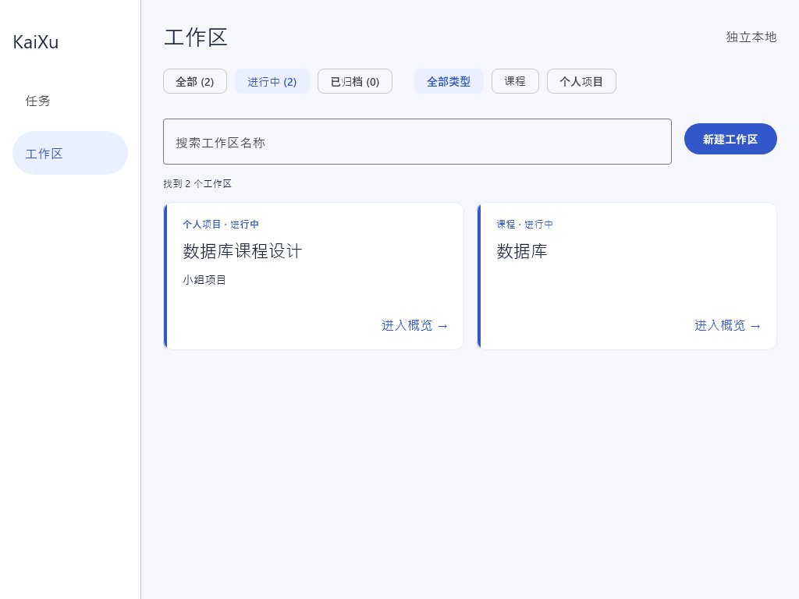
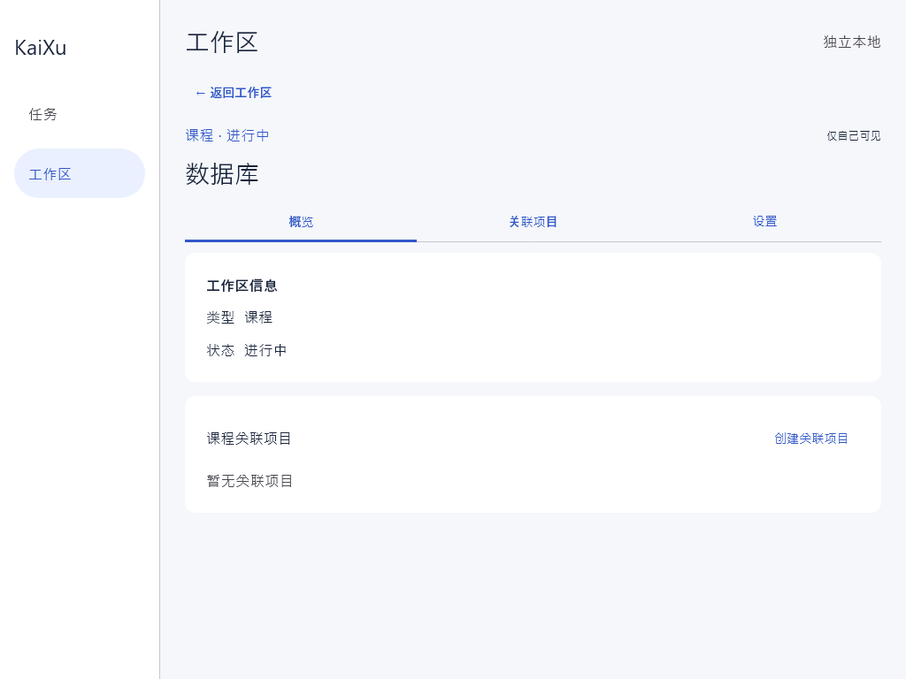
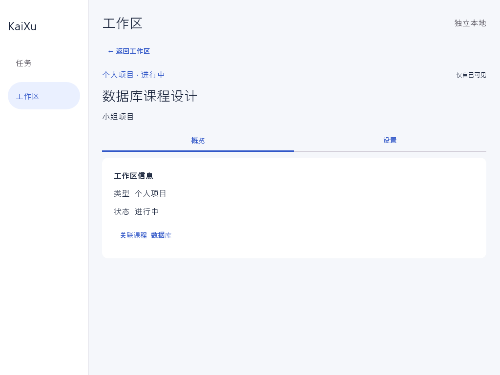

# 桌面工作区管理验证

Issue #9，依据工作区 SPEC 的 A1–A8、B1–B8。桌面独立本地模式使用 #8 的同一 Room 数据库。

## 自动验证

在 apps/client 下使用 JDK 21 运行。

```powershell
.\gradlew.bat -PdesktopOnly=true :shared:jvmTest :desktopApp:test
```

2026-11-08 本地验证通过。此功能新增 8 项 ViewModel 测试和 2 项实际 Compose 页面测试。

| 场景 | 验证位置 |
| --- | --- |
| 状态、类型、名称组合筛选及返回后保留上下文 | WorkspaceViewModelTest、WorkspaceScreenTest |
| 新建课程、课程内创建个人项目、编辑后回到概览 | WorkspaceScreenTest |
| 取消草稿、重复点击保存、保存期间禁止取消 | WorkspaceScreenTest、WorkspaceViewModelTest |
| 保存失败保留输入，保存已成功但随后读取失败只重试读取 | WorkspaceViewModelTest |
| 归档确认、归档失败反馈、恢复、已有归档课程关联 | WorkspaceViewModelTest、WorkspaceScreenTest |
| UI 创建和修改实际落库，重开同一文件后同 ID/状态/关联可读取 | WorkspaceScreenTest 与已有 WorkspaceDatabaseTest |
| 迟到的读取结果不能覆盖保存成功后的状态 | WorkspaceViewModelTest |

## 页面截图

以下图片由 WorkspaceScreenTest 从实际 Compose 页面捕获，使用真实临时 Room 文件。







## 非作者验收

评审同学使用桌面入口创建课程与项目，修改关联、归档、恢复后，完全退出应用并重新启动，核对原记录和关系。保存失败、重复提交及读取失败路径由上述自动测试补充。正式验收记录由评审同学填写。

本批概览显示工作区自身信息和课程关联。任务、日程及资料的聚合验收由 Issue #10 跟踪。AI 辅助实现页面、状态处理及测试，人工复核业务规则和合并放行。
