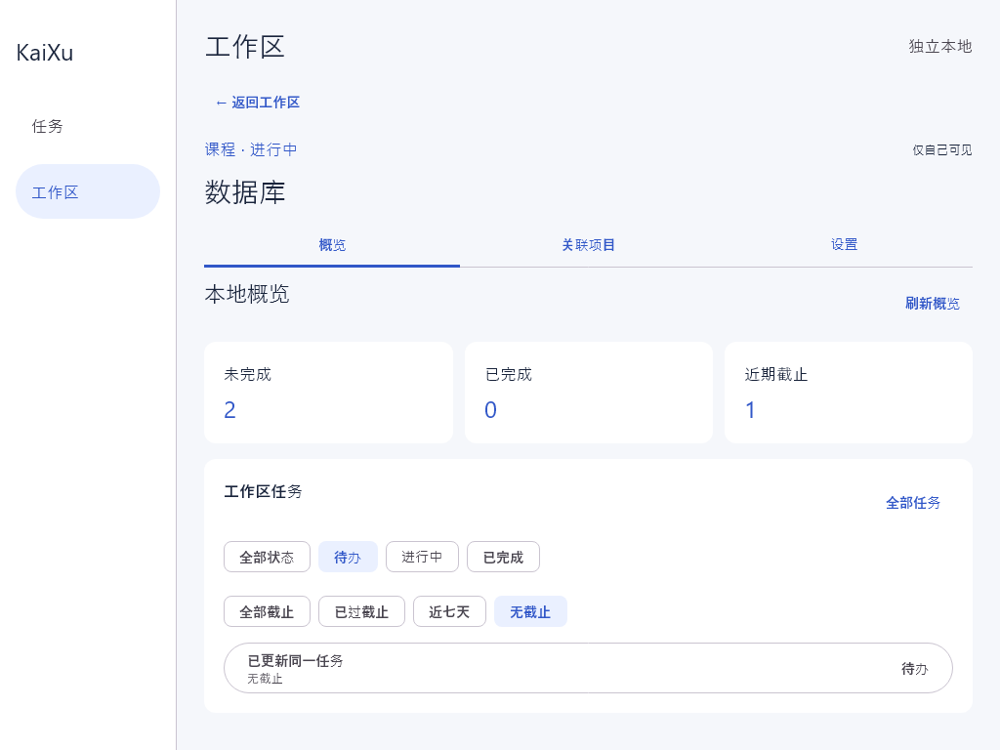
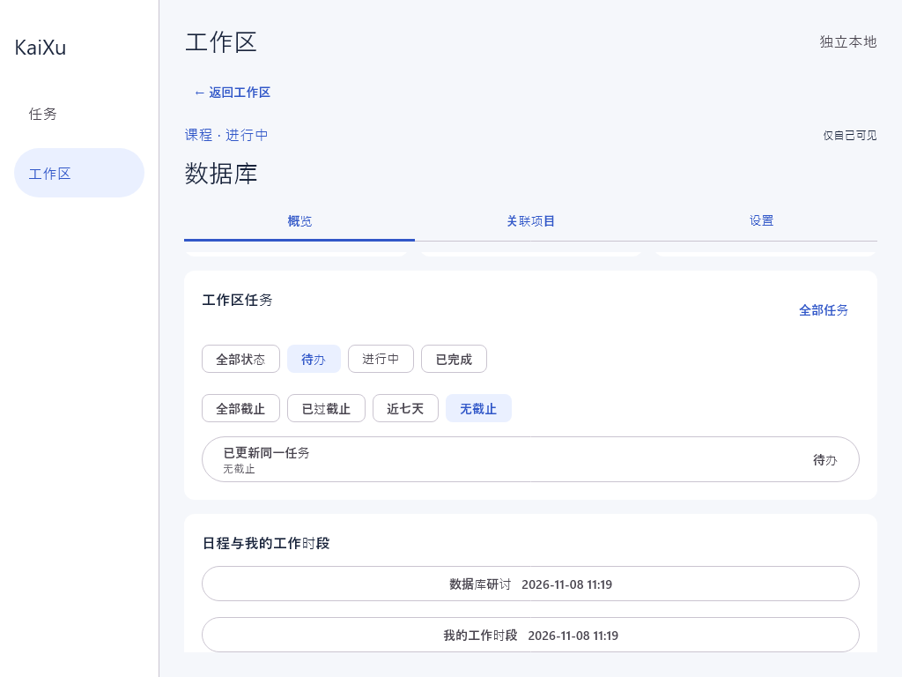

# 桌面工作区概览验证

Issue #10，依据 UC03.1–UC03.3 与《工作区 SPEC》§5。本批基于 PR #16 的桌面工作区入口，仅完成真实本地任务和日程读取、筛选及同 ID 只读详情；资料模块尚未接入，Issue 保持打开。

## 业务口径

- 工作区只聚合直接属于当前 ID 的任务、固定事件，不递归合并关联项目的数据。独立任务和事件保持原归属。
- 未完成 = 待办 + 进行中，已完成单独计数。三项统计不受任务列表筛选影响。
- 上海时区的“近期”是包含今天的七个自然日，结束点为今天加七天的零点（不含）。日期截止包含今天；精确截止从当前时刻起。近期统计排除已完成任务。
- 列表的状态与截止条件取交集。“已过截止”只表示原截止已过去，可与“已完成”组合查询；无截止任务不会被判为已过截止。
- 默认任务摘要优先显示未完成，最多四条；“全部任务”展开当前筛选结果。
- 日程显示当前工作区固定事件，以及本人绑定当前工作区任务的工作时段；不随任务列表筛选变化，包含过去和未来的记录及各种时段状态。
- 全局任务与工作区入口打开相同的只读详情，按原 ID 重读数据库。返回时刷新列表，保留输入和浏览上下文；不复制记录、不改变归属。

## 自动验证

在 apps/client 下用 JDK 21 运行：

```powershell
.\gradlew.bat -PdesktopOnly=true :shared:jvmTest :desktopApp:test
```

新增五项用例层测试、五项 ViewModel 测试（含全局任务页刷新恢复）和一项真实 Room + Compose 界面流程；全套包含前序功能测试。2026-11-08 本地验证通过，共 47 项，零失败、零跳过。

| 场景 | 证据 |
| --- | --- |
| 工作区隔离、独立记录不被归入、统计和组合筛选 | WorkspaceOverviewUseCaseTest、WorkspaceOverviewScreenTest |
| 日期截止与精确时刻边界、无截止、已完成排除近期统计 | WorkspaceOverviewUseCaseTest |
| 本人工作时段隔离；其他工作区、其他人和独立记录不混入 | WorkspaceOverviewUseCaseTest、WorkspaceOverviewScreenTest |
| 同 ID 原记录更新；详情返回工作区和全局任务页自动读取新值 | WorkspaceOverviewScreenTest：通过真实数据源更新数据库，未模拟已完成的界面编辑功能 |
| 筛选保留、切换工作区清理旧状态、迟到读取不覆盖新页 | WorkspaceOverviewViewModelTest、WorkspaceOverviewScreenTest |
| 空数据、读取失败和重试；筛选失败不显示旧筛选结果 | WorkspaceOverviewViewModelTest 使用可控失败数据源，成功路径界面测试使用真实 Room 文件 |
| 日程和个人工作时段详情导航 | WorkspaceOverviewScreenTest |
| 从个人工作时段详情返回后恢复原滚动位置 | WorkspaceOverviewScreenTest：非零滚动位置误差不超过 1 像素 |
| 全局任务刷新失败后成功重读，清除旧读取错误且保留草稿 | TaskEditorViewModelTest |

截图由实际 Compose 测试页面生成，数据来自真实临时 Room 文件：





## 待接入与人工验收

- 资料模块未实现，未提供虚假资料数量或成功入口；资料聚合和同记录跳转继续由 #10 跟踪。
- 完整任务编辑及工作区归属选择依赖 #13；日程创建、编辑和归属入口依赖 #14。本批的详情只读。跨视图更新测试直接操作持久层，不代表这些界面已实现。
- 账号、同步、在线权限由 #11 跟踪，当前只使用独立本地身份，不声称完成账号隔离联调。
- 评审同学在相应模块接入后补验：由界面创建/编辑带工作区 ID 的任务和日程，再往返全局与工作区检查同一记录；完全退出并重启应用后核对数据。资料入口完成后再补全 Issue #10 验收。

该 PR 保持草稿并使用 Refs #10。先审核 PR #16，再将本 PR 的目标分支切回 master，重跑 CI。AI 辅助实现与自动测试，另一位同学负责人工复核和合并放行。
