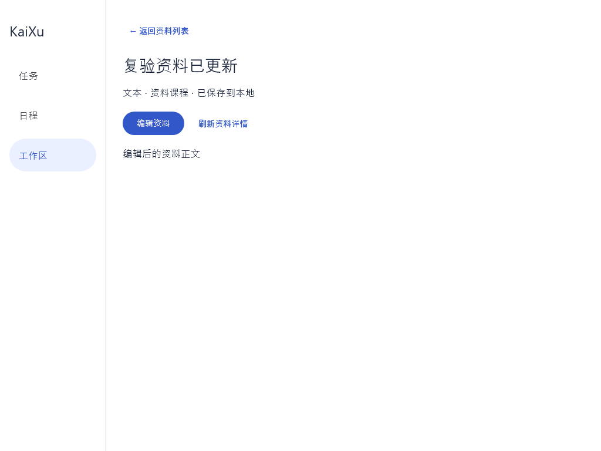

# 桌面工作区概览验证

Issue #10，依据 UC03.1–UC03.3 与《工作区 SPEC》§5。基于 PR #16 的桌面工作区入口，概览从本地 Room 读取任务、日程与资料。工作区和全局入口复用同 ID 的任务和固定事件详情。本人工作时段在此处可查看。

核对 GitHub 后，资料尚无可接入模块，#13 和 #14 的相关分支没有超出 master 的功能提交。本 PR 补齐独立本地场景所需的链接／文本资料，以及已有任务和单次固定事件的编辑。

## 业务口径

- 工作区只聚合直接属于当前 ID 的任务、固定事件，不递归合并关联项目的数据。独立任务和事件保持原归属。
- 未完成 = 待办 + 进行中，已完成单独计数。三项统计不受任务列表筛选影响。
- 上海时区的“近期”是包含今天的七个自然日，结束点为今天加七天的零点（不含）。日期截止包含今天；精确截止从当前时刻起。近期统计排除已完成任务。
- 列表的状态与截止条件取交集。“已过截止”只表示原截止已过去，可与“已完成”组合查询；无截止任务不会被判为已过截止。
- 默认任务摘要优先显示未完成，最多四条；“全部任务”展开当前筛选结果。
- 日程显示当前工作区固定事件，以及本人绑定当前工作区任务的工作时段；不随任务列表筛选变化，包含过去和未来的记录及各种时段状态。
- 全局任务、全局固定事件列表与工作区入口按原 ID 打开详情。保存后返回会重读数据库并保留工作区筛选和浏览位置。编辑保留记录 ID 与所属工作区。
- 任务可改标题、说明，未完成任务可在待办与进行中之间切换。截止日期及时间精度、完成时间和其他未编辑字段沿用原值；完成操作属于 UC11。
- 固定事件可改标题、说明和起止时间，按上海时区输入。保存事务重读原记录及工作区，检查本人固定事件和未取消工作时段的半开区间冲突。重叠需明确确认，确认时重新检查；修改内容或冲突变化会要求重新确认。
- 资料以工作区 ID 查询。概览展示真实数量及最近 3 条，资料页可按名称搜索、创建或打开同一记录。支持 HTTP(S) 链接与文本，归档工作区资料只读。Room v3→v4 迁移新增资料表，保留旧表和数据。

## 自动验证

在 apps/client 下用 JDK 21 运行：

```powershell
.\gradlew.bat -PdesktopOnly=true :shared:jvmTest :desktopApp:test
```

验证包含 PR #16 的长说明修复及原有概览测试。新增真实 Room 持久化、v3→v4 迁移、同 ID 编辑、冲突确认、资料校验和桌面界面流程。本地全套 66 项通过，零失败、零跳过。

| 场景 | 证据 |
| --- | --- |
| 工作区隔离、独立记录不被归入、统计和组合筛选 | WorkspaceOverviewUseCaseTest、WorkspaceOverviewScreenTest |
| 日期截止与精确时刻边界、无截止、已完成排除近期统计 | WorkspaceOverviewUseCaseTest |
| 本人工作时段隔离；其他工作区、其他人和独立记录不混入 | WorkspaceOverviewUseCaseTest、WorkspaceOverviewScreenTest |
| 从界面编辑原任务及固定事件，返回工作区及全局列表读到新值，重开数据库核对 ID 和归属 | WorkspaceOverviewScreenTest |
| 筛选保留、切换工作区清理旧状态、迟到读取不覆盖新页 | WorkspaceOverviewViewModelTest、WorkspaceOverviewScreenTest |
| 空数据、读取失败和重试；筛选失败不显示旧筛选结果 | WorkspaceOverviewViewModelTest 使用可控失败数据源，成功路径界面测试使用真实 Room 文件 |
| 日程和个人工作时段详情导航 | WorkspaceOverviewScreenTest |
| 从个人工作时段详情返回后恢复原滚动位置 | WorkspaceOverviewScreenTest：非零滚动位置误差不超过 1 像素 |
| 40 行说明可滚动阅读，设置和编辑入口可达，编辑框保留全文 | WorkspaceScreenTest（PR #16 的回归测试） |
| 全局任务刷新失败后成功重读，清除旧读取错误且保留草稿 | TaskEditorViewModelTest |
| 任务编辑保留截止精度和完成时间，拒绝归档、权限不足和同字段冲突 | TaskRecordEditorTest |
| 固定事件时间、重叠确认与重新校验 | EditLocalFixedEventUseCaseTest、FixedEventEditTimeTest、WorkspaceOverviewScreenTest |
| 资料创建、无效链接拒绝、同 ID 编辑、搜索返回、摘要上限和工作区隔离 | WorkspaceOverviewScreenTest、ResourceDatabaseTest、ResourceUrlTest |
| v3→v4 保留原工作区、任务、事件和工作时段，资料编辑失败回滚 | ResourceDatabaseTest |

截图由实际 Compose 测试页面生成，数据来自真实临时 Room 文件：




## 待接入与人工验收

- 资料附件、版本和任务资料关联属于后续资料功能。
- 任务完整创建和维护由 #13 跟踪。固定事件创建、删除、日周视图、重复和提醒由 #14 跟踪。
- 账号、同步及在线权限由 #11 跟踪。当前验收覆盖独立本地桌面。
- 请另一位同学按上表复核界面流程和业务规则，再决定放行。

PR #17 以 PR #16 的分支为目标，供评审单独查看本轮工作区概览的改动。PR #16 合并后，将 #17 的目标分支改为 master 并重跑 CI。AI 辅助实现与自动测试，另一位同学负责人工复核和合并放行。
